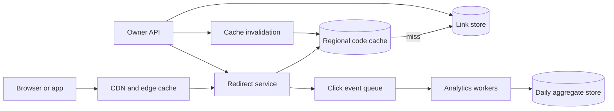

# 01. URL Shortener

**Difficulty:** Easy | **Key concepts:** ID generation, redirects, cache, expiry, analytics | **Related LeetCode:** [Encode and Decode TinyURL](../../design/0535-encode-and-decode-tinyurl-medium/README.md)

## 1. Requirements

### Functional

- Accept a long HTTP or HTTPS URL and return a short link.
- Resolve a short code to its original destination.
- Let the owner disable a link and optionally set an expiration time.
- Support an optional custom alias when the alias is available.
- Record a redirect event for later aggregate analytics.
- Keep redirect behavior independent from analytics availability.

### Non-functional

- Sustain one million daily active users in the baseline estimate.
- Keep successful redirects below 100 ms at the 99th percentile in one region.
- Target 99.99% monthly redirect availability.
- Make code creation strongly unique; a committed mapping must not disappear.
- Eventual consistency is acceptable for click counters, not for code ownership.

### Out of scope

- Browser extensions, link previews, and user-facing campaign dashboards.
- Exact real-time analytics and arbitrary per-user access controls.
- Crawling destination pages or deciding whether their content is safe.

## 2. Back-of-the-envelope estimates

### Assumptions

- 1 million daily active users create one link and follow ten links each day.
- Reads outnumber writes by 10:1.
- A mapping, including index and metadata, averages 300 bytes.
- A redirect event is 100 bytes before replication or compression.
- Keep live mappings and aggregated analytics for five years.
- Peak traffic is ten times the daily average.

### Request volume

- Creates per day: `1,000,000 × 1 = 1,000,000`.
- Redirects per day: `1,000,000 × 10 = 10,000,000`.
- Total requests per day: `11,000,000`.
- Average create QPS: `1,000,000 / 86,400 ≈ 12`.
- Average redirect QPS: `10,000,000 / 86,400 ≈ 116`.
- Peak create QPS: `12 × 10 ≈ 120`.
- Peak redirect QPS: `116 × 10 ≈ 1,160`.

### Storage and bandwidth

- Five-year created mappings: `1,000,000 × 365 × 5 = 1.825 billion`.
- Raw mapping storage: `1.825B × 300 bytes ≈ 548 GB`.
- Three replicas need about `1.65 TB`, before backups and headroom.
- Raw click-event retention: `10M × 100 bytes × 1,825 ≈ 1.83 TB`.
- Keep daily aggregates rather than five years of raw events.
- At 1 KB per redirect response, peak egress is about `1.16 MB/s`.
- A CDN can serve cached redirect responses close to clients.

### Cache estimate

- Assume the most popular 5% of codes receive 80% of redirects.
- The hot set is at most `1.825B × 5% ≈ 91 million` codes.
- At 80 bytes per cache entry that full set needs about 7.3 GB.
- Start with 10 GB per region and tune from observed hit rate.

## 3. API design

### Create

- `POST /v1/links`
- Request: `{ "url": "https://example.com/a", "expiresAt": null }`.
- Optional request field: `customAlias`.
- Response: `{ "code": "aZ81kQ", "shortUrl": "https://s.example/aZ81kQ" }`.
- Require an idempotency key so retried creates do not mint duplicates.

### Redirect

- `GET /{code}` returns `302 Found` and a `Location` header.
- Use `Cache-Control` only when the link's mutability permits it.
- Return `404` for unknown codes and `410` for expired or disabled codes.
- Do not include private analytics data in the redirect response.

### Owner operations

- `PATCH /v1/links/{code}` updates destination or expiration.
- `DELETE /v1/links/{code}` disables the mapping.
- Authenticate ownership before either operation.
- Return the current mapping version in mutation responses.

### Analytics

- `GET /v1/links/{code}/stats?from=...&to=...`
- Return approximate daily counts and a freshness timestamp.
- Paginate long time ranges instead of returning every event.

## 4. Data model

### Link table

| Field | Type | Purpose |
| --- | --- | --- |
| `code` | fixed-width string | Primary lookup key and partition key |
| `owner_id` | integer | Ownership checks and owner listing |
| `destination` | normalized URL | Redirect target |
| `created_at` | timestamp | Audit and retention |
| `expires_at` | nullable timestamp | Expiration check |
| `state` | enum | Active, disabled, or expired |
| `version` | integer | Cache invalidation and conditional update |

- Store a second index by `(owner_id, created_at)` for management pages.
- A SQL relational store fits ownership transactions and uniqueness checks initially.
- At larger scale, a sharded NoSQL key-value table fits direct code-to-destination reads.
- Keep a uniqueness constraint on `code`; a collision must never overwrite.
- Store click events separately, partitioned by `(code, event_day)`.

## 5. High-level architecture

- On a cache hit, the redirect service validates expiry and emits an event.
- On a miss, it reads the mapping store and fills the regional cache.
- Link creation commits the unique mapping before returning the short code.
- Cache invalidation follows owner mutations; version checks reject stale fills.
- Analytics consumers aggregate asynchronously and never block redirects.

## 6. Deep dives

### Short-code generation

- A sequential database ID is simple, compact, and reveals approximate volume.
- Base62 encodes an integer using URL-safe letters and digits.
- Random codes hide volume but need collision detection and retry.
- A distributed ID can be converted to Base62, but wastes space if it is wide.
- Choose random 7–8 character codes with a unique constraint and bounded retries.
- Reserve custom aliases in the same uniqueness namespace as generated codes.
- On collision, generate another candidate; never rely on probability alone.

### Redirect cache and mutation

- Cache `code → destination, expiry, version`, not a whole owner record.
- Cache popular links longer; use a modest TTL for ordinary codes.
- A disabled or edited link increments its version and publishes invalidation.
- If invalidation is delayed, the short TTL bounds stale redirects.
- Use a tombstone for deleted codes so delayed replicas cannot resurrect a link.

### Analytics isolation

- Redirect writes a small event to a durable queue with a short timeout.
- On queue failure, redirect still succeeds and a sampled counter records loss.
- Partition events by code hash and day to spread hot keys.
- Deduplicate by event ID if producers retry after an ambiguous acknowledgement.
- Keep click aggregation approximate if exact counting is not a product requirement.

## 7. Scaling, bottlenecks & failure modes

- Add read replicas or cache shards as redirect traffic grows.
- Shard the mapping table by a stable hash of `code`.
- Replicate mappings across regions; route reads to the nearest healthy region.
- Keep code creation in a home region or use globally unique random codes.
- A celebrity link can overload one cache key; use request coalescing and edge caching.
- If the cache fails, rate-limit store fallbacks and shed analytics work first.
- If the primary store is unavailable, serve cached active links and reject creates.
- If analytics is delayed, retain queue data and expose a freshness indicator.
- Protect redirects against open-redirect abuse with URL validation and takedowns.
- Apply per-owner creation limits and monitor high-risk destinations.

## 8. Trade-offs summary

| Decision | Chosen | Alternative | Why |
| --- | --- | --- | --- |
| Code assignment | Random Base62 with uniqueness check | Sequential ID | Hides volume while collision handling remains explicit |
| Redirect response | 302 by default | 301 permanent | Owners may edit destinations after creation |
| Mapping store | Transactional relational store first | Distributed KV immediately | Simpler ownership and uniqueness semantics at initial scale |
| Analytics | Durable asynchronous events | Synchronous counter update | Keeps redirect latency independent of reporting |
| Cache invalidation | Version plus TTL | TTL only | Bounds stale reads while supporting fast owner changes |

## 9. Interview follow-ups

- **Can codes be guessed?** Use sufficient entropy, rate limits, and abuse monitoring; secrecy is not authorization.
- **How are custom aliases reserved?** Put aliases and generated codes behind the same unique index.
- **What if two regions create the same random code?** A global uniqueness claim or conditional insert rejects one.
- **Can redirects be cached forever?** Only immutable mappings; mutable links need bounded freshness.
- **How are expired links cleaned up?** Enforce expiry on reads, then asynchronously delete old records.
- **What if the analytics queue is down?** Redirects remain available; events can be sampled or briefly buffered.
- **How would branded domains work?** Resolve the host to a tenant, then use the same code lookup path.

## 10. Video & further reading

- [YouTube search: system design URL shortener](https://www.youtube.com/results?search_query=system+design+URL+shortener)
- [HTTP redirection overview](https://developer.mozilla.org/en-US/docs/Web/HTTP/Redirections)
