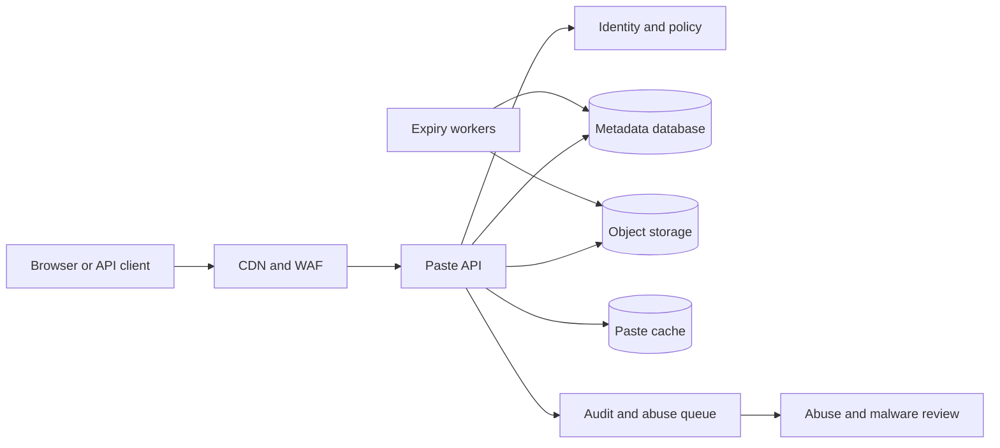

# 02. Pastebin

**Difficulty:** Easy | **Key concepts:** text ingestion, immutable objects, expiry, access control, abuse prevention | **Related LeetCode:** [In-memory file system](../../design/0588-design-in-memory-file-system-hard/README.md)

## 1. Requirements

### Functional

- Let an authenticated or anonymous user submit text and receive a short paste ID.
- Retrieve a paste by ID without requiring a database query on every read.
- Support plain text and optional syntax-label metadata.
- Allow public, unlisted, and private visibility.
- Support expiration choices, including a no-expiry option for trusted accounts.
- Let owners delete or edit a paste when policy permits it.
- Provide raw-text retrieval for embedding in editors and scripts.

### Non-functional

- Return an existing paste within 150 ms at the 99th percentile in-region.
- Keep paste creation durable after the API reports success.
- Target 99.9% availability for reads and writes.
- Preserve private-paste authorization; unlisted IDs are not access control.
- Cap paste size, read frequency, and lifetime for anonymous traffic.
- Serve popular immutable revisions through a CDN.

### Out of scope

- Collaborative editing, full version history, and rich document rendering.
- Executing pasted code or guaranteeing that a paste is harmless.
- Search across private paste contents.

## 2. Back-of-the-envelope estimates

### Assumptions

- 500,000 daily active users create two pastes per day.
- Each paste is viewed six times on average.
- The average stored body is 10 KB after text normalization.
- Metadata and indexes add 1 KB per paste.
- Retain active pastes for five years unless they expire sooner.
- Peak load is ten times average; regional replication factor is three.

### Request volume

- Creates per day: `500,000 × 2 = 1,000,000`.
- Reads per day: `1,000,000 × 6 = 6,000,000`.
- Average create QPS: `1,000,000 / 86,400 ≈ 12`.
- Average read QPS: `6,000,000 / 86,400 ≈ 69`.
- Peak reads approach 690 QPS, before skew from a viral paste.
- Peak create rate is approximately 120 QPS.

### Storage and bandwidth

- Five-year paste count: `1M × 365 × 5 = 1.825 billion`.
- Raw bodies: `1.825B × 10 KB ≈ 18.25 TB`.
- Metadata: `1.825B × 1 KB ≈ 1.83 TB`.
- Three copies require roughly 60 TB before backups and compaction.
- Keep blobs compressed; use a lifecycle policy to delete expired bodies.
- At 10 KB per read and 690 peak reads/s, peak body egress is about 6.9 MB/s.
- CDN egress should absorb most traffic for popular immutable pastes.

### Cache estimate

- Assume 10% of IDs receive 80% of fetches.
- A cache holding 50 million hot metadata records at 200 bytes uses 10 GB.
- Cache bodies only for the highest-traffic subset to control memory cost.
- Use negative caching briefly for nonexistent IDs to reduce repeated misses.

### Five-year footprint, traffic, and cache check

- The assumed read-to-create ratio is `6:1` (six views per new paste).
- Five-year metadata and bodies: `1M × 1,825 × 11 KB ≈ 20 TB` raw.
- Three copies of that five-year corpus require about 60 TB before backups.
- Peak body bandwidth is `690 reads/s × 10 KB ≈ 6.9 MB/s`.
- A 10 GB cache holds about `50M × 200 bytes` of hot metadata entries.
- Cache hot bodies separately and size that tier from the observed popularity curve.

## 3. API design

### Create a paste

- `POST /v1/pastes`
- Request: `{ "text": "...", "visibility": "unlisted", "expiresIn": 86400 }`.
- Optional fields include `title`, `syntax`, and a client idempotency token.
- Response: `{ "id": "pA73k", "url": "https://paste.example/pA73k" }`.
- Return `413` when the body exceeds the account's size limit.

### Read

- `GET /v1/pastes/{id}` returns metadata and a short display URL.
- `GET /v1/pastes/{id}/raw` streams the body with a safe text content type.
- Private pastes require an owner or explicit access token.
- Expired and deleted IDs return a distinct `410 Gone` response.

### Update and delete

- `PATCH /v1/pastes/{id}` updates allowed metadata or creates a new revision.
- `DELETE /v1/pastes/{id}` marks the paste unavailable and schedules blob deletion.
- Require an owner credential; never infer ownership from the paste ID.
- Return the revision number for conditional updates.

### Listing

- `GET /v1/users/{userId}/pastes?cursor=...` lists recent owner pastes.
- Use opaque keyset cursors rather than offset paging.
- Public discovery is intentionally not part of the baseline API.

## 4. Data model

### Paste metadata

| Field | Type | Purpose |
| --- | --- | --- |
| `paste_id` | random string | Primary key and shareable identifier |
| `owner_id` | nullable ID | Ownership and user listing |
| `blob_key` | object key | Location of compressed text |
| `visibility` | enum | Public, unlisted, or private |
| `expires_at` | timestamp | Read-time expiry and cleanup |
| `revision` | integer | Conditional edit and cache version |
| `syntax` | short string | Display hint, never code execution |

- Store paste bodies in object storage, addressed by a random blob key.
- Keep metadata in a relational store initially for ownership and policy updates.
- Index `(owner_id, created_at)` for the user's recent-pastes page.
- Partition metadata by `paste_id` after the table outgrows one primary.
- A blob is immutable per revision; edits point metadata to a new blob.
- Put expiration in metadata and in object-storage lifecycle tags.

### Storage choice

- SQL metadata supports owner, visibility, revision, and expiry updates with clear constraints.
- Text bodies belong in object storage; a NoSQL metadata store is an option after partitioned keyed reads dominate.

## 5. High-level architecture

- Creation validates the body and visibility before storing a compressed blob.
- The metadata transaction publishes the ID only after the blob write succeeds.
- Reads authorize first, then fetch metadata and retrieve the immutable blob.
- The cache stores metadata and, for hot IDs, the body keyed by revision.
- Expiry workers remove old objects; read-time checks enforce the deadline meanwhile.

## 6. Deep dives

### Paste IDs and privacy

- Sequential IDs leak creation order and make bulk enumeration easy.
- Random IDs with at least 96 bits of entropy make guessing impractical.
- The ID is still not an authorization token for private content.
- Use a signed, scoped access token if a private paste must be shared.
- Rate-limit invalid-ID lookups and return uniform errors where enumeration matters.

### Body storage and revisions

- A database BLOB is easy to transact but makes backups and replication expensive.
- Object storage handles large immutable bodies cheaply and supports streaming.
- Upload the object first, then commit metadata; orphan objects are cleaned later.
- Use a revision-specific blob key so an update never overwrites a body being read.
- If metadata commit fails, enqueue the new object for cleanup.
- Compress UTF-8 text, but enforce both compressed and decompressed size limits.

### Expiration and abuse

- Enforce expiry at read time; background deletion is eventual cleanup, not policy.
- Queue new public pastes for sampling and user reports for urgent review.
- Apply byte, request, and account quotas before accepting the body.
- Never render raw HTML from an untrusted paste in the product origin.
- Set `Content-Disposition` and a restrictive content type for raw responses.

## 7. Scaling, bottlenecks & failure modes

- Add CDN caching for public immutable revisions; invalidate on visibility changes.
- Shard metadata by paste ID and replicate reads to nearby regions.
- Large-paste downloads should stream from object storage through an edge proxy.
- If object storage is degraded, keep metadata but return a retryable read failure.
- If metadata is unavailable, do not serve private cached content without fresh policy.
- A cache outage should fall back to the database with per-ID request coalescing.
- If the expiry queue lags, the API still rejects expired pastes synchronously.
- Apply per-IP and per-account quotas to prevent upload and lookup abuse.
- Redact body contents and access tokens from application logs.
- Use tombstones to prevent a delayed replica from restoring a deleted paste.

## 8. Trade-offs summary

| Decision | Chosen | Alternative | Why |
| --- | --- | --- | --- |
| Body store | Object storage | Database BLOB | Cheap immutable content and independent scaling |
| Paste ID | Random high-entropy code | Sequential integer | Makes enumeration materially harder |
| Edits | New immutable revision | Overwrite blob | Safer concurrent reads and cache versioning |
| Expiration | Read-time check plus async deletion | Scheduled deletion only | Delayed workers cannot extend access |
| Visibility | Explicit private/unlisted/public modes | One shared-link mode | Unlisted is convenient but is not authorization |

## 9. Interview follow-ups

- **How do private links work?** Authorize an owner or scoped token; the random ID alone grants no rights.
- **What happens if blob upload succeeds but metadata fails?** Keep the object unreachable and delete it asynchronously.
- **Can a paste be edited without changing its URL?** Yes; metadata advances to an immutable new revision and invalidates cache.
- **How do you prevent HTML-based attacks?** Escape display text, isolate rendering, and serve raw content as plain text.
- **How are expired objects removed?** Enforce expiry on reads, then let lifecycle and cleanup workers reclaim storage.
- **How would search be added?** Index only eligible public content asynchronously with deletion tombstones.
- **How do you handle a viral paste?** Cache the body at the CDN and coalesce origin fetches by revision.

## 10. Video & further reading

- [YouTube search: system design Pastebin](https://www.youtube.com/results?search_query=system+design+Pastebin)
- [Amazon S3 object lifecycle management](https://docs.aws.amazon.com/AmazonS3/latest/userguide/object-lifecycle-mgmt.html)
