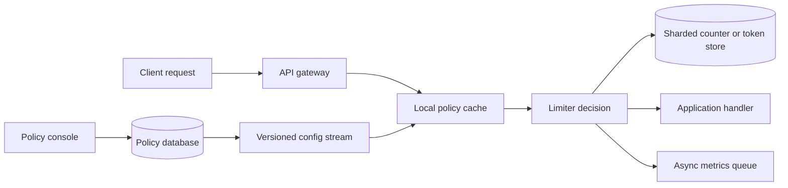

# 03. Rate Limiter

**Difficulty:** Medium | **Key concepts:** admission control, token bucket, distributed counters, policy, fairness | **Related LeetCode:** [Logger Rate Limiter](../../design/0359-logger-rate-limiter-easy/README.md), [Design Hit Counter](../../design/0362-design-hit-counter-medium/README.md)

## 1. Requirements

### Functional

- Enforce limits by user, API key, IP, endpoint, or a combination of keys.
- Support policies such as 100 requests per minute and burst allowances.
- Return allow/deny and include a retry hint when a request is rejected.
- Let operators change policies without deploying application code.
- Exempt internal health checks and explicitly trusted service identities.
- Emit usage metrics without making the decision depend on analytics.

### Non-functional

- Add less than 5 ms at the 99th percentile for an in-region decision.
- Keep the limiter highly available; a control-plane outage must not erase policy.
- Bound clock skew and counter error for each policy's stated accuracy target.
- Fail open or closed per endpoint risk, rather than with one global setting.
- Expire idle key state so cardinality cannot grow without limit.

### Out of scope

- Billing-grade exact request accounting.
- Detecting abusive intent beyond the configured request policy.
- Scheduling long jobs after a request is denied.

## 2. Back-of-the-envelope estimates

### Assumptions

- 2 million daily active clients issue 50 API requests each per day.
- There are 100 million requests per day and 10 million active limiter keys.
- A counter state averages 64 bytes before datastore overhead.
- Peak request rate is twelve times the daily average.
- A typical client has a 100-request-per-minute policy.

### Request volume

- Average decision QPS: `100M / 86,400 ≈ 1,157`.
- Peak QPS: `1,157 × 12 ≈ 13,884`.
- At two datastore operations per decision, peak backend load is about 28K ops/s.
- Batch pipelining can reduce network round trips but not logical decisions.
- Configuration reads are cached and should be far less frequent than requests.

### State and bandwidth

- Raw state: `10M keys × 64 bytes = 640 MB`.
- With three replicas and 2× overhead, provision about 3.8 GB.
- A 20-byte request key at peak is roughly `278 KB/s` before protocol overhead.
- A compact allow/deny response at 100 bytes is about `1.4 MB/s` peak.
- Keep a short TTL on inactive state; size memory from observed key churn.
- Policy history is small and can be stored durably in a relational database.

### Five-year footprint, traffic, and cache check

- Assume policy-state reads outnumber policy edits by `10:1`; decisions are not all persisted.
- Five-year decision-history storage, if every `100M` daily decision is archived at 32 bytes, would cost `5.84 PB` raw.
- Keep short-lived counters in the 3.8 GB replicated state tier and aggregate long-term audit data.
- Peak request and response payload at 128 bytes each is about `13,884 × 256 ≈ 3.6 MB/s`.
- Cache 100,000 one-kilobyte policy documents in roughly 100 MB per region.
- The active counter store, not historical decisions, is the hot cache sizing target.

## 3. API design

### Decision endpoint

- Internal RPC: `CheckLimit(subject, action, cost, requestId)`.
- Response: `{ allowed, remaining, resetAt, retryAfterMs, policyVersion }`.
- `cost` defaults to one and allows expensive endpoints to consume more tokens.
- A request ID makes retry behavior observable but does not replace idempotency.

### Policy administration

- `PUT /v1/limits/{policyId}` writes a versioned policy document.
- Fields include key dimensions, algorithm, capacity, refill/window, and fallback.
- `GET /v1/limits/{policyId}` returns the active version and validation errors.
- Publish a change only after parsing and bounds validation succeeds.

### Rejection response

- HTTP `429 Too Many Requests` includes a conservative `Retry-After`.
- Include remaining budget and reset time only when safe for the caller.
- Avoid disclosing another tenant's configured quota.

## 4. Data model

### Policy

| Field | Type | Purpose |
| --- | --- | --- |
| `policy_id` | string | Stable policy identity |
| `scope` | enum | Account, key, IP, route, or composite |
| `algorithm` | enum | Token bucket, fixed window, or sliding approximation |
| `capacity` | integer | Maximum burst or window count |
| `refill_rate` | rate | Token replenishment |
| `version` | integer | Safe rollout and audit |

- Store policy documents durably and distribute immutable versions to limiters.
- Partition runtime state by stable hash of `(policy_id, subject_hash)` to colocate decisions and spread clients.
- Token-bucket state is `(tokens, last_refill_time, version)`.
- Hash or tokenize sensitive subject identifiers before remote storage.
- Use a datastore command/script to read, refill, decide, and write atomically.

### Storage choice

- SQL fits versioned policy edits and audit history; it is not on the per-request decision path.
- A sharded in-memory key-value store provides atomic token updates and automatic TTL expiry.

## 5. High-level architecture

- The gateway identifies the subject and chooses the applicable policy.
- A local immutable policy cache avoids a database lookup on every request.
- The decision store performs an atomic update for the selected subject key.
- Allowed traffic continues to the handler; denied traffic returns immediately.
- Metrics leave through an asynchronous path separate from the request decision.

## 6. Deep dives

### Choosing the algorithm

- Fixed windows are simple and cheap but allow a double-sized burst at a boundary.
- Sliding logs are precise but store one timestamp per request.
- Sliding counters interpolate two adjacent windows with bounded approximation.
- Token buckets permit bursts up to capacity while limiting long-run average rate.
- Use token buckets for interactive APIs and fixed counters for coarse daily quotas.
- Document exactly whether the limit is strict, approximate, or burst tolerant.

### Distributed atomicity

- A process-local counter is fast but multiplies quota by the number of replicas.
- A central datastore gives shared state but adds a network hop and failure domain.
- Use a colocated script or atomic primitive so concurrent requests cannot overdraw.
- Shard by subject hash and route every request for a subject to the same shard.
- For regional limits, allocate regional token budgets and reconcile conservatively.
- Avoid synchronous cross-region consensus for a low-latency per-request decision.

### Failure behavior

- Fail closed for costly or security-sensitive actions.
- Fail open briefly for low-risk reads if the limiter store is unavailable.
- Apply a local emergency budget during fail-open mode to prevent unbounded overload.
- Keep a bounded local policy snapshot and reject unknown policy versions safely.
- Expose degraded mode and fallback decisions as separate metrics.

## 7. Scaling, bottlenecks & failure modes

- Partition state by hashed subject and scale the shard count horizontally.
- A single large tenant can become a hot key; use sub-buckets with a bounded merge.
- For global limits, use a dedicated quota service or leased token allocations.
- Cache policy versions locally and push invalidations with monotonically increasing versions.
- If the counter store slows, shed low-priority traffic before it exhausts application pools.
- If configuration publication stalls, keep the last validated policy and alert.
- On process restart, restore no local counters unless their consistency model is explicit.
- Put TTLs on idle buckets and cap the number of dimensions in a composite key.
- Protect the limiter itself with request budgets, circuit breakers, and admission queues.
- Measure rejected traffic separately from backend errors and legitimate demand.

## 8. Trade-offs summary

| Decision | Chosen | Alternative | Why |
| --- | --- | --- | --- |
| Default algorithm | Token bucket | Fixed window | Smooth average with a configurable burst |
| Shared state | Atomic sharded store | Per-process counters | Keeps the quota meaningful across replicas |
| Policy rollout | Versioned push plus local cache | Read policy on every request | Reduces latency and configuration load |
| Failure mode | Endpoint-specific | Always fail open | Preserves controls on sensitive operations |
| Key handling | Hashed subject key | Raw identifiers | Limits exposure in the counter tier |

## 9. Interview follow-ups

- **Why not use a local counter?** Replica count changes the effective limit.
- **How do you handle a hot key?** Lease sub-budgets to workers and cap total leased capacity.
- **What happens at a window boundary?** Choose and disclose the algorithm's burst semantics.
- **Can a limit change take effect immediately?** Versioned pushes make propagation observable but not instantaneous.
- **What if the limiter datastore fails?** Apply the endpoint's explicit local fallback budget.
- **How do you avoid charging retries twice?** Couple admission with request idempotency at the business operation.
- **How is fairness measured?** Track accepted/rejected rates by tenant and queue delay by class.

## 10. Video & further reading

- [YouTube search: system design rate limiter](https://www.youtube.com/results?search_query=system+design+rate+limiter)
- [Redis rate limiter design pattern](https://redis.io/learn/howtos/ratelimiting)
