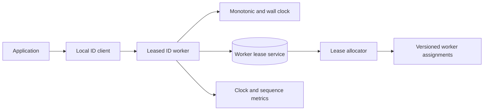

# 04. Unique ID Generator

**Difficulty:** Easy | **Key concepts:** Snowflake layout, worker assignment, clock rollback, sequence overflow | **Related LeetCode:** No directly related problem in the current repository.

## 1. Requirements

### Functional

- Generate globally unique identifiers from any healthy application region.
- Keep IDs sortable by approximate creation time.
- Return IDs without a synchronous database round trip.
- Support multiple independent workers and safe worker replacement.
- Provide a parser for timestamp, worker, and sequence fields where operationally useful.

### Non-functional

- Sustain 100,000 IDs per second fleet-wide with low generation latency.
- Keep IDs within signed 64-bit range for supported retention horizon.
- Make duplicate generation impossible under the documented clock and worker assumptions.
- Continue serving IDs during a control-plane outage when workers hold valid leases.
- Avoid embedding sensitive customer data in an identifier.

### Out of scope

- Strict total ordering across all regions at the same millisecond.
- A globally gap-free sequence.
- Database auto-increment semantics for a single table.

## 2. Back-of-the-envelope estimates

### Assumptions

- Peak demand is 100,000 IDs per second across the fleet.
- One worker can issue 4,096 IDs in a millisecond before sequence wrap.
- A 10-bit worker field permits 1,024 concurrently leased workers.
- A 12-bit sequence field is reset each millisecond.
- Use a 41-bit millisecond timestamp from a custom epoch.
- The assembled ID uses 63 bits and fits a signed 64-bit integer.
- Assume 100 million DAU request ten IDs/day on average; 100,000 IDs/s is the peak planning rate.

### Throughput and horizon

- Average ID-generation QPS is `100M DAU × 10 IDs / 86,400 ≈ 11.6K`; peak target is 100K QPS.
- Per-worker theoretical limit: `4,096 × 1,000 = 4.096M IDs/s`.
- 100,000 peak IDs/s needs at least `ceil(100,000 / 4.096M) = 1` worker by raw rate.
- Allocate 64 workers for isolation, headroom, and rolling maintenance.
- A 41-bit millisecond timestamp spans `2^41 / 1000 / 60 / 60 / 24 / 365 ≈ 69.7 years`.
- A 12-bit sequence resets each millisecond and permits 4,096 IDs per worker.
- A 10-bit worker field supports 1,024 leases, not 1,024 permanent hostnames.

### State and network

- Worker state is a worker ID, last millisecond, and sequence: well below 100 bytes.
- At 100,000 IDs/s, 8-byte IDs produce about 0.8 MB/s of payload.
- Persisting every ID centrally would add 100,000 writes/s and a bottleneck.
- Worker leases and health heartbeats are small relative to ID traffic.
- Keep lease metadata in a replicated control-plane store, not on the hot path.

### Five-year footprint, traffic, and cache check

- ID generation dominates lease reads; assume at least `100,000:1` generated IDs per lease refresh.
- At the peak rate sustained for five years, `100K × 86,400 × 1,825 ≈ 15.8T` IDs are generated.
- Five-year ID storage upper bound: persisting each ID as an 8-byte value separately would require about 126 TB.
- Peak ID payload bandwidth is `100K × 8 bytes ≈ 0.8 MB/s`; control traffic is negligible.
- The generator has no result cache; each worker keeps less than 1 KB of lease and sequence state.
- The 1,024-entry worker assignment map is a few tens of kilobytes and fits in each process.

## 3. API design

### Generate

- Internal RPC: `GenerateId(namespace, count=1)`.
- Response: `{ ids: [uint64], generatorEpoch, workerRegion }`.
- Allow bounded batch generation to amortize RPC overhead.
- A worker may also generate locally when its lease and clock health are valid.

### Inspect and health

- `GET /internal/id-generator/health` reports clock drift, sequence pressure, and lease expiry.
- `GET /internal/id-generator/parse/{id}` is an operator tool, not a public API.
- Do not expose worker topology or lease secrets to clients.

### Namespace handling

- Namespace is not necessarily part of the numeric bit layout.
- If separate namespaces need uniqueness, allocate disjoint worker or epoch ranges.
- Document whether IDs are unique globally or only within a namespace.

## 4. Data model

### Bit layout example

| Bits | Field | Interpretation |
| ---: | --- | --- |
| 41 | Milliseconds since custom epoch | Approximate creation time |
| 10 | Worker lease ID | Unique generator process during lease |
| 12 | Per-millisecond sequence | Disambiguates IDs from one worker |

- Control-plane lease row: `(worker_id, owner, region, expires_at, fencing_token)`.
- Worker memory state: `(last_timestamp_ms, sequence, fencing_token)`.
- The fencing token increments on lease reassignment and blocks stale owners.
- Partition the small lease registry by `worker_id`; generation itself stays local to each worker.
- Store generated IDs with their application records; the generator is not the source of business state.

### Storage choice

- Use a transactional SQL or consensus-backed lease table for worker assignments, not ID issuance.
- Keep generation state in worker memory; a SQL sequence on every request would centralize throughput.

## 5. High-level architecture

- The allocator grants worker IDs with leases and fencing tokens.
- Each generator process validates the lease before producing IDs.
- The local client batches requests and avoids a shared database on the hot path.
- The generator combines timestamp, worker assignment, and local sequence.
- A control-plane observer detects workers approaching sequence or clock limits.

## 6. Deep dives

### Worker ID allocation

- A fixed worker ID in configuration is simple but fails during duplicate deployment.
- Dynamic leases assign IDs to instances and expire abandoned assignments.
- Lease acquisition must be conditional and atomic.
- Include a monotonically increasing fencing token in every lease renewal.
- A process with an expired token must stop generating even if it still runs.
- Reuse a worker ID only after the old lease is fenced and any clock overlap is handled.

### Clock rollback and sequence overflow

- Wall clocks can jump backward after NTP correction, VM restore, or host migration.
- If time equals the previous millisecond, increment the sequence.
- If time moves backward, wait briefly for catch-up or fail closed and alert.
- If the sequence reaches its limit, wait for the next millisecond; never wrap in place.
- A monotonic clock helps detect elapsed time but does not replace epoch timestamp bits.
- Define a maximum tolerated skew and a recovery procedure for large jumps.

### Alternatives

- UUIDv4 offers decentralized uniqueness but no useful time ordering.
- UUIDv7 places time first and works well when database locality is less important.
- Database sequences are simple for one database but centralize write throughput.
- Snowflake-style IDs trade strict cross-region ordering for compact, local generation.
- Pick the scheme based on index locality, privacy, and client requirements.

## 7. Scaling, bottlenecks & failure modes

- Add generator workers before any one worker approaches its per-millisecond limit.
- Spread leases across zones and regions; detect duplicate worker ownership.
- If the lease service is down, valid unexpired workers may continue until lease expiry.
- Stop generation when lease renewal fails beyond the configured grace period.
- Alert on clock skew, sequence saturation, lease churn, and future timestamps.
- Quarantine a host restored from an old VM snapshot until its clock and lease are safe.
- If the control plane is unavailable, do not reassign possibly-live worker IDs blindly.
- Keep an emergency reserve of worker IDs for rapid fleet growth.
- Use a custom epoch and monitor the remaining timestamp horizon.
- Test failover with clock jumps and simultaneous worker restarts.

## 8. Trade-offs summary

| Decision | Chosen | Alternative | Why |
| --- | --- | --- | --- |
| Generation | Worker-local Snowflake format | Central SQL sequence | Avoids a write bottleneck for a high-volume fleet |
| Worker assignment | Fenced leases | Static host IDs | Prevents duplicate ownership during replacement |
| Time source | Wall time plus rollback guard | Wall time only | Prevents time reversal from reusing ID ranges |
| Ordering | Approximate timestamp order | Global total order | Lower latency without cross-region consensus |
| Identifier | 63-bit integer | Random UUID | Compact index key where sortable IDs are valuable |

## 9. Interview follow-ups

- **What if two workers share an ID?** Lease fencing prevents reuse until the old owner is invalidated.
- **What if the clock moves backward?** Pause or fail the worker; never reset sequence under an older timestamp.
- **Can IDs be guessed?** Yes; do not use them as authorization tokens.
- **Does the format leak time?** It reveals approximate creation time and worker allocation; use opaque IDs if that is unacceptable.
- **How is a new region added?** Increase leased worker capacity and verify bit-field headroom.
- **Why not use UUIDv4?** UUIDv4 is simpler but larger and less index-local for some storage engines.
- **How do you test uniqueness?** Simulate concurrent workers, restarts, clock drift, and lease expiration.

## 10. Video & further reading

- [YouTube search: system design unique ID generator](https://www.youtube.com/results?search_query=system+design+unique+ID+generator)
- [RFC 9562: UUID formats](https://www.rfc-editor.org/rfc/rfc9562)
