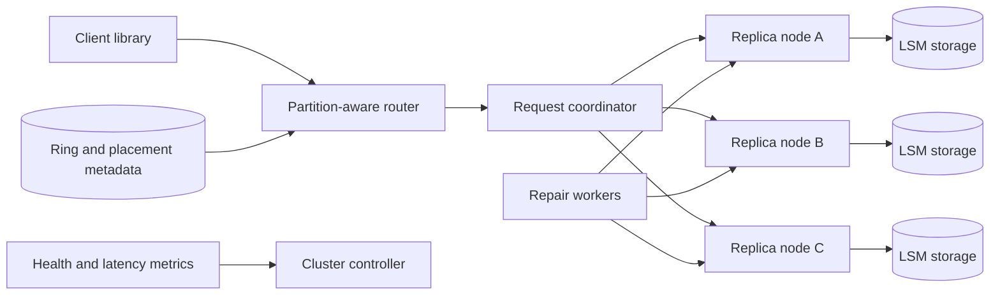

# 05. Dynamo-Style Key-Value Store

**Difficulty:** Hard | **Key concepts:** consistent hashing, replication, quorums, hinted handoff, anti-entropy, LSM trees | **Related LeetCode:** No directly related problem in the current repository.

## 1. Requirements

### Functional

- Store and retrieve values by a caller-supplied key.
- Support overwrite, conditional write, delete tombstone, and batch reads.
- Replicate data across nodes and availability zones.
- Allow tunable read/write quorum for latency and consistency trade-offs.
- Repair replicas after temporary node or network failures.
- Expose capacity, latency, and replication-health metrics.

### Non-functional

- Sustain 10,000 writes/s and 50,000 reads/s at peak.
- Target p99 read latency below 30 ms within a region.
- Remain available through a single node or zone outage.
- Bound stale reads through an explicit consistency mode.
- Keep acknowledged writes durable on at least two failure domains.
- Scale capacity by adding nodes without a full-table rewrite.

### Out of scope

- Arbitrary multi-key transactions and relational joins.
- Full-text search or server-side ad hoc filtering.
- A globally linearizable write path for every key.

## 2. Back-of-the-envelope estimates

### Assumptions

- 10 million daily active clients perform 20 reads and 5 writes per day.
- 250 million operations/day, of which 200 million are reads.
- Peak traffic is ten times average.
- One billion live keys average 1 KB of value plus 200 bytes of index/metadata.
- Replication factor is three; reserve 30% for compaction and repair.
- Average value response is 1 KB; average request key is 32 bytes.

### Request volume

- Average write QPS: `50M / 86,400 ≈ 579`.
- Average read QPS: `200M / 86,400 ≈ 2,315`.
- Peak write QPS: about 5,790.
- Peak read QPS: about 23,150.
- With three replicas, peak replica writes approach 17,400 operations/s.
- One million hot keys can dominate load despite modest total key count.

### Storage and bandwidth

- Primary logical storage: `1B × 1.2 KB ≈ 1.2 TB`.
- Three replicas: `3.6 TB`; with 30% headroom, provision about 4.7 TB.
- Keep tombstones longer than the maximum expected replica outage.
- Peak read egress: `23,150 × 1 KB ≈ 23 MB/s`.
- Peak write ingress is roughly `5,790 × 1.2 KB ≈ 7 MB/s`.
- Compaction and repair traffic need separate network headroom.

### Cache

- If 5% of keys drive 80% of reads, hot data is about 50 million keys.
- At 1.2 KB each, that hot set is about 60 GB before cache overhead.
- Begin with 64–96 GB of distributed cache and measure skew and hit rate.
- Cache versioned values; tombstones must invalidate older positive entries.

### Five-year footprint, traffic, and cache check

- The assumed read-to-write ratio is `4:1` from 200M reads and 50M writes per day.
- A flat inventory of one billion live keys remains about 1.2 TB logical; retaining five years of 50M daily versions adds `50M × 1,825 × 1.2 KB ≈ 110 TB`.
- Three copies of that version history would require roughly 330 TB before compaction and backups.
- Peak request payload is about 23 MB/s on reads plus 7 MB/s on writes.
- A 60 GB hot cache holds the modeled 50 million frequently read keys at 1.2 KB each.
- Keep cache and replica placement aligned with key partitions to avoid extra network hops.

## 3. API design

### Core operations

- `PUT /v1/kv/{key}` writes a value and returns a version token.
- `GET /v1/kv/{key}?consistency=quorum` reads a value and version.
- `DELETE /v1/kv/{key}` writes a tombstone rather than erasing history immediately.
- `PUT /v1/kv/{key}` may include `If-Match: <version>` for compare-and-set.
- `POST /v1/kv:batchGet` accepts bounded keys from one or several partitions.

### Semantics

- A write response states the durability level reached, such as quorum.
- A read response may include siblings when concurrent writes conflict.
- Return `404` for no live value, while a tombstone still participates in reconciliation.
- Bound item size and reject invalid keys before routing.
- Use request IDs for safe retries after network timeouts.

## 4. Data model

### Replica record

| Field | Type | Purpose |
| --- | --- | --- |
| `key_hash` | fixed-width hash | Partition and replica placement |
| `key` | bytes | Original key for collision verification |
| `value` | bytes | Stored payload, nullable for tombstone |
| `version_vector` | compact vector | Detects concurrent writes |
| `timestamp` | hybrid/logical clock | Deterministic conflict preference |
| `expires_at` | optional timestamp | TTL expiration |

- Use a partitioned LSM-tree on each storage node for write-heavy workloads.
- Keep a sparse in-memory index and bloom filter to reduce disk seeks.
- Store replication factor, placement epoch, and token ownership in cluster metadata.
- Keep tombstones through the repair horizon, then compact only after all replicas agree.
- Avoid treating wall-clock timestamps as proof that one user write is newer.

### Storage choice

- A distributed NoSQL key-value engine fits partitioned direct lookups, quorum replication, and horizontal growth.
- SQL would be preferable for multi-row constraints, but those transactions are explicitly out of scope here.

## 5. High-level architecture

- The router hashes the key and identifies the replica set for its token range.
- A coordinator sends reads or writes to the selected replicas in parallel.
- Quorum logic evaluates acknowledgements and returns the configured result.
- Anti-entropy workers compare replica summaries and repair divergent ranges.
- Membership changes publish a new placement epoch before moving data.

## 6. Deep dives

### Partitioning and rebalancing

- Hash the key to distribute ordinary keys uniformly across a token ring.
- Assign multiple virtual tokens per node to reduce imbalance during placement.
- Replication chooses distinct zones before choosing distinct hosts.
- Adding a node changes only the token ranges it takes ownership of.
- Stream data in bounded chunks and throttle movement to protect foreground I/O.
- Track old and new ownership epochs so routers do not write to stale owners.

### Quorum and conflict resolution

- With `N=3`, a common policy is `R=2` and `W=2`.
- `R + W > N` makes read and write quorums intersect, but does not alone guarantee serializability.
- Concurrent writes may still create siblings; expose or resolve them explicitly.
- Last-write-wins is simple but can discard a valid update because clocks differ.
- Version vectors preserve concurrency but make clients or merge logic more complex.
- For counters and sets, use a data type with a defined merge operation.

### Repair and hinted handoff

- A temporary failed replica can receive a hinted write from a healthy peer.
- Hints are durable, bounded, and replayed when the owner returns.
- Anti-entropy compares Merkle-tree ranges to avoid scanning all values.
- Read repair can fix the key observed during a quorum read.
- Do not discard tombstones until every replica has passed the deletion version.

### Storage engine

- An LSM tree converts random writes into sequential log and sorted-file writes.
- Bloom filters and sparse indexes reduce lookup cost across levels.
- Compaction consumes disk bandwidth and can create write amplification.
- Separate foreground and compaction queues with explicit throttles.
- Monitor disk space for temporary compaction copies, not just final data size.

## 7. Scaling, bottlenecks & failure modes

- Add nodes to increase storage and request capacity, then rebalance token ranges.
- A hot key cannot be fixed by hashing; use application-level sharding or read replicas.
- If one replica is slow, return when quorum is reached and repair it asynchronously.
- If quorum is unavailable, apply the configured consistency policy and surface failure.
- During a network partition, prevent both sides from silently claiming strong consistency.
- Disk-full nodes should stop accepting writes before compaction becomes impossible.
- Replication lag and hint backlog need age-based alerts, not only queue length.
- A bad placement change can trigger a cluster-wide movement storm; rate-limit it.
- Use per-tenant quotas to prevent large values or scans from starving small requests.
- Test rolling upgrades against mixed protocol and storage versions.

## 8. Trade-offs summary

| Decision | Chosen | Alternative | Why |
| --- | --- | --- | --- |
| Partitioning | Consistent-hash token ranges | Fixed partitions | New nodes can take ranges incrementally |
| Replication | Three zones, tunable quorum | One primary copy | Availability through node or zone loss |
| Storage engine | LSM tree | B-tree | Efficient sequential write path |
| Conflict handling | Version metadata and explicit policy | Blind last-write-wins | Makes concurrency loss visible |
| Repair | Hints plus anti-entropy | Full replica copy after failure | Bounded recovery traffic |

## 9. Interview follow-ups

- **Does `R + W > N` give linearizability?** No; concurrent writes and sloppy quorums need more coordination.
- **How are hot keys handled?** Cache reads, replicate hot values, or split the logical key at the application layer.
- **When can a tombstone be removed?** Only after the repair and maximum-outage horizon guarantees no stale copy can return.
- **How does a node join?** It takes token ranges and receives throttled streaming before becoming authoritative.
- **What if two replicas disagree?** Compare versions and merge according to the value's conflict policy.
- **Why use a Bloom filter?** It avoids disk reads for keys definitely absent from an SSTable.
- **How would transactions be added?** Introduce a consensus-backed coordination path for the required scope, with a latency cost.

## 10. Video & further reading

- [YouTube search: system design key value store](https://www.youtube.com/results?search_query=system+design+key+value+store)
- [Dynamo: Amazon's Highly Available Key-value Store](https://www.allthingsdistributed.com/files/amazon-dynamo-sosp2007.pdf)
