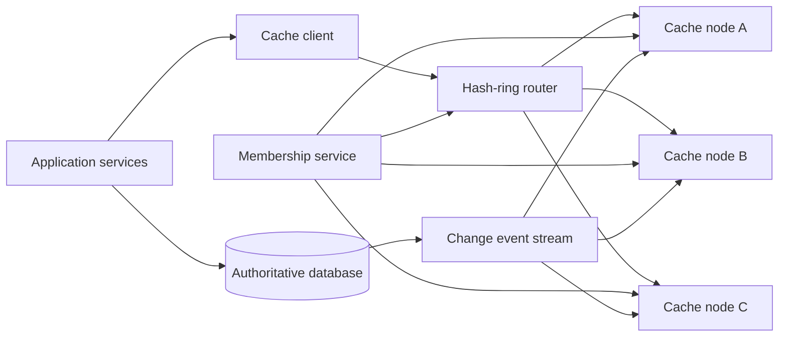

# 06. Distributed Cache

**Difficulty:** Medium | **Key concepts:** cache-aside, sharding, eviction, replication, hot keys, invalidation | **Related LeetCode:** [LFU Cache](../../design/0460-lfu-cache-hard/README.md)

## 1. Requirements

### Functional

- Read and write values by key across a fleet of cache nodes.
- Support TTL, explicit invalidation, and bounded item size.
- Distribute keys across nodes and relocate ownership as capacity changes.
- Provide a cache-aside client API for application services.
- Expose hit rate, eviction, memory, and per-node latency metrics.
- Permit namespace-level quotas and separate pools for workload classes.

### Non-functional

- Keep cache lookup under 2 ms at p99 within a region.
- Avoid making the cache the only durable copy of business data.
- Scale memory capacity by adding or removing nodes without global flush.
- Preserve bounded memory usage under arbitrary key churn.
- Degrade safely when a shard is unavailable or an item cannot be cached.

### Out of scope

- Cross-key transactions and durable authoritative writes.
- A perfectly coherent, linearizable cache across regions.
- Arbitrary query execution over cached values.

## 2. Back-of-the-envelope estimates

### Assumptions

- 5 million daily active users make 40 application reads each per day.
- 200 million reads/day, with a 90% target cache hit rate.
- 20 million distinct hot keys are active in the working set.
- Average value is 1 KB; key, expiry, and allocator overhead add 200 bytes.
- Each node uses at most 70% of installed RAM for item storage.
- Peak is twelve times the daily average.

### Request volume

- Average read QPS: `200M / 86,400 ≈ 2,315`.
- Peak read QPS: about 27,800.
- At 90% hit rate, the cache serves about 25,000 peak reads/s.
- The authoritative data tier receives roughly 2,800 peak cache misses/s.
- Write or invalidation rate must be measured separately; assume 1,000/s peak.

### Capacity and network

- Hot-set bytes: `20M × 1.2 KB ≈ 24 GB`.
- At 70% usable memory, minimum installed RAM is `24 / 0.7 ≈ 34 GB`.
- With one replica and 30% growth margin, provision at least 90 GB.
- Six 16-GB nodes provide 96 GB usable fleet RAM before replica accounting.
- Peak response payload: `25K × 1 KB ≈ 25 MB/s`.
- Rebalancing 24 GB over 30 minutes needs about 13 MB/s of background transfer.

### Five-year footprint, traffic, and cache check

- Assume application reads outnumber cache refresh writes by about `10:1`.
- The cache itself is transient; for 1M new 1.2 KB source records/day, five-year source growth is `1M × 1,825 × 1.2 KB ≈ 2.2 TB`.
- The modeled cache working set is 24 GB; with replicas and growth headroom, provision about 90 GB.
- Peak cache response bandwidth is approximately 25 MB/s, before protocol overhead.
- Co-locate a 1 GB directory/metadata cache with the 20M hot keys if key discovery needs it.
- Cache capacity is a bounded working set, not a five-year retention commitment.

## 3. API design

### Client interface

- `GET key` returns value, miss, or a typed cache error.
- `SET key value ttl` writes a value and optional expiration.
- `DELETE key` invalidates one entry.
- `MGET keys[]` groups requests by shard and returns per-key results.
- `SET_IF_VERSION key version value` supports guarded refreshes where needed.

### Cache-aside behavior

- On read miss, the application fetches the source of truth and fills the cache.
- On update, commit to the source of truth first, then invalidate or write-through.
- Use request coalescing so concurrent misses for one key share a single source read.
- Use a short randomized TTL to avoid synchronized expiration waves.

## 4. Data model

### In-memory entry

| Field | Type | Purpose |
| --- | --- | --- |
| `key_hash` | fixed hash | Shard routing and hash-table lookup |
| `key` | bytes | Collision check |
| `value` | bytes | Cached response or derived data |
| `expires_at` | monotonic deadline | TTL evaluation |
| `version` | source version | Reject stale asynchronous fills |
| `access_metadata` | compact counters/list links | Eviction policy |

- Use a hash table for expected O(1) key access inside each node.
- Partition keys by a stable hash; place replicas in separate failure domains.
- Keep eviction metadata compact; pointer-heavy structures waste RAM.
- Separate control-plane membership from item data.
- Do not persist the cache as the only copy of authoritative application state.

### Storage choice

- The cache is an in-memory key-value tier, not a durable SQL database or system of record.
- Keep authoritative data in the application's SQL or NoSQL store and treat cache entries as disposable.

## 5. High-level architecture

- The client maps each key to a primary node and optional replica.
- The node checks expiry and returns the value without a source database call.
- Miss handling remains in the application so source ownership is explicit.
- Database change events invalidate or version cache entries asynchronously.
- Membership updates carry an epoch so clients agree on routing during rebalance.

## 6. Deep dives

### Sharding and replication

- Consistent hashing limits the keys moved when a node is added.
- Virtual nodes smooth capacity differences but increase ring metadata.
- Replicate a key to a different host and preferably a different zone.
- Reads may use the nearest healthy replica; writes and invalidations reach all copies.
- A stale replica is acceptable only within the product's documented freshness window.
- During membership transition, dual-read or forwarding avoids avoidable cold misses.

### Eviction and TTL

- LRU approximates recency and is useful for many request workloads.
- LFU protects frequently reused entries but can retain once-hot stale items.
- TinyLFU-style admission can reject scans that would evict genuinely hot values.
- TTL is a freshness bound, not a substitute for invalidation after a write.
- Add jitter to expiry times and expire lazily on access plus background sweeps.
- Prefer segmented pools when one workload could evict another tenant's entire working set.

### Stampede and hot keys

- Coalesce concurrent fills for the same key within each application process.
- Add a bounded distributed lock only if duplicate source reads are costly.
- Use stale-while-revalidate when serving a slightly old value is safe.
- Replicate or cache at the edge for exceptionally hot immutable values.
- Randomize refresh times to prevent a synchronized cache miss wave.

## 7. Scaling, bottlenecks & failure modes

- Add nodes gradually and throttle key movement to preserve foreground latency.
- Alert on memory fragmentation, eviction rate, network saturation, and hot partitions.
- When a node fails, remap keys and apply backpressure to the source database.
- If the cache fleet is unavailable, use a bounded fallback path rather than unbounded reads.
- Keep circuit breakers and per-service miss budgets at the application layer.
- A full flush can overload the database; require staged invalidation and warm-up.
- If invalidation events lag, version checks or short TTLs bound stale data.
- Oversized objects should bypass cache or use a separate large-object tier.
- Hash-flooding and unbounded key cardinality require validation and quotas.
- Never log secrets or complete sensitive cached values during troubleshooting.

## 8. Trade-offs summary

| Decision | Chosen | Alternative | Why |
| --- | --- | --- | --- |
| Application integration | Cache-aside | Cache as authority | Source of truth remains explicit |
| Placement | Consistent hash | Modulo node count | Node changes move fewer keys |
| Eviction | Segmented LRU/LFU admission | Pure LRU | Protects stable hot keys from one-time scans |
| Freshness | Event invalidation plus TTL | TTL only | Faster updates without trusting events alone |
| Failure | Bounded source fallback | Unlimited pass-through | Prevents cache outage from cascading |

## 9. Interview follow-ups

- **Why can a cache stampede happen?** Many requests observe the same expired key simultaneously.
- **How does a node join affect the hit rate?** Some keys move and become cold; rate-limit transfer and warm hot keys.
- **When is stale-while-revalidate safe?** When product semantics tolerate bounded staleness.
- **How do you prevent cache poisoning?** Validate source, namespace keys, and use source versions.
- **What happens if all entries expire at midnight?** Jitter TTLs and refresh asynchronously.
- **How are hot keys handled?** Replicate them, serve them at the edge, or split their logical load.
- **Can Redis be the source of truth?** Only with a deliberate durability and recovery model; ordinary cache assumptions are insufficient.

## 10. Video & further reading

- [YouTube search: system design distributed cache](https://www.youtube.com/results?search_query=system+design+distributed+cache)
- [Memcached architecture overview](https://docs.memcached.org/)
