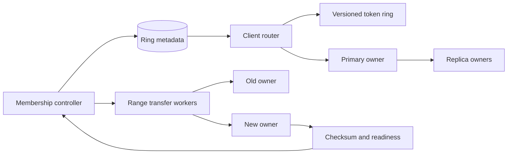

# 07. Consistent Hashing

**Difficulty:** Medium | **Key concepts:** hash ring, virtual nodes, replica placement, rebalancing, membership epochs | **Related LeetCode:** No directly related problem in the current repository.

## 1. Requirements

### Functional

- Map arbitrary keys to storage or cache nodes deterministically.
- Add and remove nodes with movement limited to a fraction of the keyspace.
- Support heterogeneous node capacity through weighted ownership.
- Place replicas on distinct hosts and, where possible, distinct zones.
- Publish membership changes to routers and clients in a versioned form.
- Measure ownership balance and movement during reconfiguration.

### Non-functional

- Route a key in logarithmic time in the number of ring tokens.
- Keep placement stable while membership is unchanged.
- Avoid concentrating replicas in one failure domain.
- Complete a node change without overwhelming network or disk capacity.
- Detect disagreement between clients using different ring versions.

### Out of scope

- Deciding whether a replicated data model is strongly consistent.
- Choosing application semantics for conflict resolution.
- Balancing every individual hot key by hashing alone.

## 2. Back-of-the-envelope estimates

### Assumptions

- 100 storage nodes serve 100 million distinct keys.
- Each node owns 256 virtual tokens, for 25,600 ring points.
- Each key's routing hash is 64 bits.
- Each key has a 1 KB value; ownership metadata is held in memory.
- A membership change should move about the new node's capacity share.
- Illustrative load is 10M DAU, 100M routed reads/day, and 100 membership writes/day (a 1,000,000:1 ratio); peak routing is ten times the daily average.

### Lookup and metadata

- Average lookup QPS is `100M / 86,400 ≈ 1,157`; the tenfold peak is about 11,570 QPS.
- Binary-searching 25,600 tokens requires about `log2(25,600) ≈ 15` comparisons.
- At 16 bytes per token record, the ring uses roughly 410 KB per router.
- The 64-bit ring has `2^64` possible positions; collisions are handled explicitly.
- With 100 equal nodes, one added node should receive about `1 / 101 ≈ 0.99%` of keys.
- For 100 million keys, that is about 990,000 keys, not a complete reshuffle.

### Movement and capacity

- Moving 990,000 keys at 1 KB each is about 1 GB of logical payload.
- At 100 MB/s of reserved transfer, the ideal lower bound is about 10 seconds.
- Real transfer time is longer because of checksums, writes, and live traffic.
- Metadata-only ring distribution is small; bulk key movement is the dominant cost.
- Use observed node weights instead of assuming all machines have equal capacity.

### Five-year footprint, traffic, and cache check

- Assume each routed key lookup is served locally and membership changes occur once per day.
- One daily 410 KB ring snapshot for five years is `410 KB × 1,825 ≈ 748 MB` raw; three copies are about 2.2 GB.
- Range movement is data-plane traffic; the example node addition moves about 1 GB at a time.
- A router's in-memory cache is the current 410 KB ring plus a small previous epoch.
- At one million local lookups/s and a 16-byte key, input bandwidth is only about 16 MB/s.
- Ring metadata is small; provision rebalance bandwidth from the underlying data store's object size.

## 3. API design

### Placement API

- `owner(key, ringEpoch)` returns the primary node and replica set.
- `owners(keys[])` batches routing for a client request.
- `getRing()` returns tokens, node identities, weights, zones, and an epoch.
- `acknowledgeEpoch(node, epoch)` records that a node is ready for new ownership.

### Reconfiguration API

- `proposeMembership(changeId, nodes, weights)` validates a desired ring.
- `beginRebalance(changeId, rateLimit)` streams ranges to new owners.
- `commitMembership(changeId)` activates the new epoch after readiness checks.
- `abortMembership(changeId)` stops movement and leaves the old ring authoritative.

## 4. Data model

### Ring metadata

| Field | Type | Purpose |
| --- | --- | --- |
| `token` | unsigned integer | Position on the hash circle |
| `node_id` | stable identifier | Owner of the token's following range |
| `weight` | numeric | Relative capacity used to allocate tokens |
| `zone` | string | Failure-domain placement |
| `epoch` | integer | Version of ownership metadata |

- Sort token positions in a compact array for binary search.
- Hash keys with a stable, well-distributed hash function and fixed seed.
- Store range handoff state separately from the immutable ring snapshot.
- Hash each data key to a token; its successor identifies the node partition that owns the key.
- Hash each data key to a token; its successor identifies the node partition that owns the key.
- A transition record tracks old owner, new owner, cursor, and checksum.
- Use stable node IDs; IP addresses alone are not durable placement identities.

### Storage choice

- Store ring membership and epochs in a small consensus-backed metadata table.
- A SQL table is useful for audited membership changes; key ownership itself is computed from the in-memory ring.

## 5. High-level architecture

- Routers load a signed ring snapshot and cache it with an epoch number.
- A key hash selects the first clockwise token and then the replica placement.
- The controller allocates tokens and computes the desired owner set.
- Transfer workers copy range data and report progress, checksums, and lag.
- The controller activates a new epoch only after owners are ready to serve it.

## 6. Deep dives

### Virtual nodes and weighted capacity

- One token per physical node can create large ownership variance.
- Multiple virtual nodes smooth variance and let one node own disjoint ranges.
- Assign token counts proportional to CPU, memory, or measured service capacity.
- Too many tokens increase metadata and make rebalancing harder to reason about.
- Simulate ring balance before activation and compare expected versus observed bytes.
- Use per-range weights if value sizes vary substantially by key.

### Replica placement

- Walking clockwise for the next token may choose the same host repeatedly.
- Skip tokens whose physical host or zone is already selected.
- Require replica count and zone spread to fit the available topology.
- A topology change should not silently reduce durability.
- Replicas can occupy different ring ranges while still preserving key-level placement.

### Safe rebalancing

- Copy data before changing read ownership; this is a make-before-break rollout.
- During transition, forward writes or dual-write with an idempotent transfer log.
- Record a high-water mark so the destination can catch up to live changes.
- Verify checksums by range and compare record counts before cutover.
- Retain the old owner's copy until the new epoch is stable and rollback is safe.
- Reject requests from a stale client epoch or redirect them to the current owner.

## 7. Scaling, bottlenecks & failure modes

- Rebalance a bounded number of ranges at once and throttle background bandwidth.
- A node failure changes ownership for its ranges; replicas serve while replacements recover.
- If ring epochs diverge, route through a forwarding owner and alert on stale clients.
- If a token collision occurs, use a deterministic secondary salt and verify uniqueness.
- Heterogeneous disk size can make equal token counts badly imbalanced.
- Very large objects may dominate bytes even when key counts are even.
- Hot keys remain hot; use replication, caching, or application-level key splitting.
- Topology labels must be accurate or supposedly independent replicas share a rack.
- A failed rebalance must resume from a durable cursor or cleanly roll back.
- Monitor moved bytes, ownership coefficient of variation, and per-node request rate.

## 8. Trade-offs summary

| Decision | Chosen | Alternative | Why |
| --- | --- | --- | --- |
| Ownership | Hash ring with virtual nodes | Modulo hashing | Membership changes move only affected ranges |
| Balance | Weighted token counts | Equal node share | Capacity and observed load differ |
| Membership | Versioned ring snapshot | Ad hoc client discovery | Routers can agree on ownership epoch |
| Rebalance | Copy then cut over | Immediate ownership change | Preserves availability during movement |
| Replica topology | Distinct zones first | Next ring tokens only | Reduces correlated failure risk |

## 9. Interview follow-ups

- **Why not use modulo hashing?** Adding a node changes ownership for nearly every key.
- **How many virtual nodes are enough?** Measure ownership variance and metadata cost for the actual node count.
- **Does consistent hashing solve hot partitions?** No; it balances key distribution, not skewed request volume.
- **How do writes work during movement?** Forward or dual-write from a durable high-water mark until catch-up.
- **How are replicas selected?** Walk the ring while enforcing host and zone diversity.
- **What if clients have stale ring metadata?** Check epochs and forward to the authoritative owner.
- **How do you scale one large tenant?** Add tenant-aware partitioning or shard that tenant's keyspace separately.

## 10. Video & further reading

- [YouTube search: system design consistent hashing](https://www.youtube.com/results?search_query=system+design+consistent+hashing)
- [Consistent hashing and random trees](https://dl.acm.org/doi/10.1145/258533.258660)
