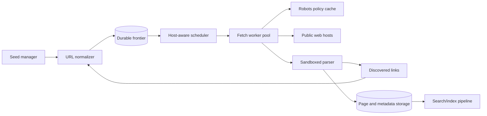

# 08. Web Crawler

**Difficulty:** Medium | **Key concepts:** URL frontier, politeness, robots.txt, deduplication, retries, content fingerprints | **Related LeetCode:** No directly related problem in the current repository.

## 1. Requirements

### Functional

- Crawl seed URLs, discover links, normalize them, and enqueue eligible pages.
- Fetch pages while respecting robots.txt, host limits, and crawl delay.
- Avoid repeatedly fetching unchanged or duplicate content.
- Store fetched metadata and content for downstream indexing.
- Support recrawl priority, domain exclusions, and operator takedowns.
- Record fetch status, redirect chain, content type, and crawl timestamp.

### Non-functional

- Sustain 10 million successful page fetches per day.
- Avoid excessive load on any one host, even when it owns many URLs.
- Scale workers horizontally and resume after machine failures.
- Keep crawl decisions explainable and auditable.
- Isolate malformed, hostile, or oversized content from parsers.

### Out of scope

- Ranking search results or answering user queries.
- Crawling authenticated sites or bypassing access controls.
- Guaranteeing a complete copy of the public web.

## 2. Back-of-the-envelope estimates

### Assumptions

- Target 10 million successful fetches per day.
- Average response body is 50 KB after transfer compression.
- Average page reveals 20 candidate links; 10% are new after normalization.
- Keep 100 million fetched page records for a rolling period.
- Peak fetch throughput is ten times average.
- Each worker permits at most one active request per host.

### Request and link volume

- Average fetch QPS: `10M / 86,400 ≈ 116 pages/s`.
- Peak fetch QPS: about 1,160 pages/s.
- Candidate links discovered daily: `10M × 20 = 200M`.
- New candidate URLs after a 10% admission rate: about 20M/day.
- Frontier must expire or deduplicate old URLs to avoid unbounded growth.

### Storage and bandwidth

- Average body ingress: `116 × 50 KB ≈ 5.8 MB/s`.
- Peak body ingress: about 58 MB/s, excluding headers and retries.
- Retained page bodies: `100M × 50 KB ≈ 5 TB` raw.
- Store compressed bodies or extracted text according to downstream need.
- URL metadata at 300 bytes per record is about 30 GB for 100M pages.
- Keep a separate content-fingerprint index to collapse duplicate bodies.

### Five-year footprint, traffic, and cache check

- Fetches and discoveries are roughly `10M` pages versus `20M` new candidates per day.
- Five years of fetched bodies at 50 KB each is `10M × 1,825 × 50 KB ≈ 913 PB` before deduplication.
- Five-year URL metadata at 300 bytes per fetched page is about 5.5 TB raw.
- Peak body ingress is about 58 MB/s; discovered-link records add a separate write stream.
- A cache of 50M hot URL-policy records at 300 bytes each needs about 15 GB.
- Cache robots rules and host politeness state separately, with expiry and conservative fallback.

## 3. API design

### Frontier control

- `POST /internal/frontier/enqueue` submits normalized URL and discovery metadata.
- `POST /internal/frontier/lease` leases a bounded batch for one worker.
- `POST /internal/frontier/complete` records status, redirects, and discovered links.
- `POST /internal/frontier/retry` schedules retry with backoff and failure reason.
- Each lease includes a fencing token and deadline.

### Operator control

- `PUT /v1/crawl-policy/{domain}` updates allow, deny, rate, and recrawl rules.
- `POST /v1/urls/{id}/suppress` prevents future fetch and schedules data removal.
- `GET /v1/crawl-health?domain=...` shows queue age, last fetch, and robots state.
- Apply an auditable principal to every manual policy change.

## 4. Data model

### URL record

| Field | Type | Purpose |
| --- | --- | --- |
| `url_hash` | fixed hash | Deduplication and partition key |
| `canonical_url` | normalized string | Stable request identity |
| `host_key` | registrable domain | Politeness bucket |
| `next_fetch_at` | timestamp | Recrawl scheduling |
| `state` | enum | Queued, leased, fetched, retry, blocked |
| `lease_epoch` | integer | Reject stale worker completion |

- Store URL state in a durable partitioned key-value or relational table.
- Keep a per-host scheduler record for robots policy, tokens, and active leases.
- Store page bodies in object storage under an immutable fetch ID.
- Index content fingerprints to identify exact or near-duplicate responses.
- Retain redirect aliases separately so canonicalization does not lose provenance.

### Storage choice

- A partitioned NoSQL frontier suits high-volume keyed URL state and independent host queues.
- Relational storage remains useful for crawl policy and audit changes with transactional constraints.

## 5. High-level architecture

- Seed URLs enter normalization and dedupe before they reach the frontier.
- The scheduler leases only hosts with available politeness capacity.
- Fetchers consult cached robots rules and apply timeout and body-size bounds.
- Parsers extract links and metadata in a sandbox with CPU and memory limits.
- Results are durable before the lease is acknowledged as complete.

## 6. Deep dives

### Frontier scheduling and politeness

- A global FIFO queue can starve slow hosts or overload one popular domain.
- Partition scheduling by host and maintain per-host next-eligible time.
- Honor robots directives and crawl-delay where defined by policy.
- Use a token bucket per host with a conservative default rate.
- Lease a small number of URLs at once so workers cannot hoard a host's queue.
- Recheck policy at fetch time because robots or deny rules may change.
- Exponential backoff with jitter avoids retry storms after host failures.

### URL normalization and deduplication

- Normalize scheme and host casing, remove fragments, and normalize default ports.
- Do not reorder query parameters unless the site semantics are known.
- Resolve relative links against the final response URL after redirects.
- Canonical tags are hints, not proof that two resources are identical.
- Keep both requested URL and canonical destination for audit and diagnostics.
- Hash normalized URLs for efficient lookup, then compare canonical strings on collision.

### Content and duplicate detection

- Use exact body hashes for byte-identical pages.
- A SimHash or shingle fingerprint can identify near-duplicate content.
- Avoid dropping pages solely because their templates are similar.
- Record content type and charset before parsing; reject unsupported binary bodies.
- Set maximum response bytes and decompression ratio to limit bomb payloads.
- Parse scripts as data only; do not execute fetched content.

## 7. Scaling, bottlenecks & failure modes

- Increase worker count only when the scheduler and target-host limits permit it.
- A large domain can produce a hot frontier partition; shard its queue by URL while retaining one host limiter.
- If robots retrieval fails, use a conservative cached policy or pause that host.
- If a worker crashes, lease expiry returns its URLs without duplicate permanent state.
- Fencing tokens prevent a delayed worker from overwriting a newer fetch result.
- Queue growth signals insufficient capacity or a too-permissive discovery policy.
- Slow parsers need separate pools from network fetchers.
- Object-store failure should pause completion rather than discard fetched content.
- Track redirect loops and cap the number of hops.
- Use an emergency denylist for legal, security, and privacy requests.

## 8. Trade-offs summary

| Decision | Chosen | Alternative | Why |
| --- | --- | --- | --- |
| Scheduling | Per-host frontier | Global FIFO | Enforces politeness and fairness |
| URL identity | Conservative normalization | Aggressive canonical collapse | Avoids merging semantically distinct URLs |
| Retry | Delayed exponential backoff | Immediate retry | Prevents synchronized load on failing sites |
| Content dedupe | Hash plus near-duplicate signal | URL-only dedupe | Saves storage for mirrors and generated aliases |
| Fetching | Sandboxed workers | In-process arbitrary parsing | Contains hostile or malformed content |

## 9. Interview follow-ups

- **How do you avoid crawling loops?** Canonical URL dedupe, redirect-hop limits, and host policy.
- **How do you treat robots.txt?** Cache versioned rules and apply conservative behavior on fetch failure.
- **What happens when a worker dies?** Its lease expires and the URL returns to the frontier with retry metadata.
- **How do you prioritize recrawls?** Combine freshness, change rate, importance, and host budget.
- **Can two URLs share content?** Fingerprint bodies and retain aliases rather than losing URL provenance.
- **How are malicious pages handled?** Bound transfer and decompression, sandbox parsers, and never execute content.
- **How do you honor a removal request?** Suppress recrawl and remove retained content through an auditable deletion workflow.

## 10. Video & further reading

- [YouTube search: system design web crawler](https://www.youtube.com/results?search_query=system+design+web+crawler)
- [RFC 9309: Robots Exclusion Protocol](https://www.rfc-editor.org/rfc/rfc9309)
