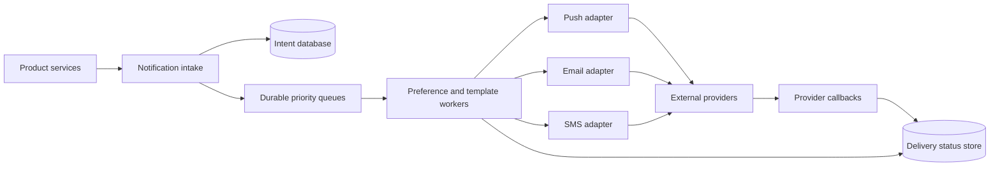

# 09. Notification System

**Difficulty:** Medium | **Key concepts:** fan-out, preferences, channel adapters, retries, delivery receipts, idempotency | **Related LeetCode:** [Design Event Manager](../../design/3885-design-event-manager-medium/README.md)

## 1. Requirements

### Functional

- Accept notification intents from product services and validate their schema.
- Deliver through push, email, SMS, or in-app channels according to user preferences.
- Support urgent, scheduled, and digest notifications.
- Deduplicate retried producer requests and preserve a delivery audit trail.
- Allow users to opt out by category and channel.
- Track queued, attempted, delivered, bounced, and permanently failed states.

### Non-functional

- Accept 100 million notification intents per day with burst absorption.
- Start urgent delivery within five seconds at p99 under normal load.
- Keep provider outages from blocking unrelated channels.
- Respect regional data residency and consent requirements.
- Make retries bounded and idempotent at the provider boundary when supported.

### Out of scope

- Designing email content templates or push-device operating systems.
- Guaranteeing that a third-party provider displays a delivered message.
- Product-specific ranking of which notification should be shown first.

## 2. Back-of-the-envelope estimates

### Assumptions

- 20 million daily active users receive five notifications each per day.
- 100 million notification intents/day; average fan-out is 1.3 channels.
- Average rendered payload and delivery metadata total 1 KB.
- Retain detailed delivery records for 30 days.
- Peak rate is ten times the daily average.

### Request volume

- Average intent QPS: `100M / 86,400 ≈ 1,157`.
- Average channel-delivery QPS: `130M / 86,400 ≈ 1,505`.
- Peak provider attempts approach 15,000 QPS before retry traffic.
- A provider outage can multiply queued work, so queue capacity must exceed steady state.
- Urgent and bulk traffic need separate admission classes.

### Storage and bandwidth

- Thirty-day detailed records: `100M × 30 × 1 KB ≈ 3 TB`.
- Three replicas require about 9 TB before indexes and compaction.
- Queue payload bandwidth at peak: about `15 MB/s`.
- A push payload may be only a few KB, but provider response metadata adds overhead.
- Store template variables separately when payloads contain sensitive personal data.
- Retain aggregated metrics longer than per-recipient delivery records.

### Five-year footprint, traffic, and cache check

- Assume delivery-status reads average five per submitted intent, a `5:1` read-to-intent ratio.
- Five-year intents at 1 KB are `100M × 1,825 × 1 KB ≈ 182.5 TB`; 1.3 channel attempts per intent add about 237 TB of delivery records.
- Three copies of intent and delivery history require roughly 1.26 PB before indexes and cleanup.
- Peak queue payload bandwidth is about 15 MB/s; provider retries add burst headroom.
- Cache preferences for 20M users at 200 bytes each in about 4 GB per region.
- Keep provider templates and channel credentials in separate, smaller caches.

## 3. API design

### Submit intent

- `POST /v1/notifications`
- Request includes `eventId`, recipient or audience, category, priority, and template data.
- Response returns an accepted intent ID and a deduplication result.
- Require producer identity and schema version.
- A bounded batch endpoint accepts multiple independent intents.

### Preferences

- `GET /v1/users/{id}/notification-preferences` returns channels and category controls.
- `PATCH /v1/users/{id}/notification-preferences` updates consent with a version.
- Channel adapters recheck high-risk opt-outs immediately before sending.
- An unsubscribe link updates email consent using a signed, scoped token.

### Status

- `GET /v1/notifications/{id}` returns aggregate delivery state.
- `GET /v1/notifications/{id}/attempts?cursor=...` provides paginated audit details.
- Provider webhooks are authenticated and idempotently applied.
- Never expose another recipient's address or provider token in status responses.

## 4. Data model

### Intent and delivery

| Field | Type | Purpose |
| --- | --- | --- |
| `intent_id` | unique ID | Idempotency and status lookup |
| `producer_event_id` | string | Deduplication across producer retries |
| `recipient_id` | account ID | Preference resolution |
| `category` | enum | Consent and suppression policy |
| `channel` | enum | Push, email, SMS, or in-app attempt |
| `state` | enum | Queued, leased, sent, bounced, or failed |

- Persist intent before acknowledging it to the producer.
- Derive a stable delivery id from `(intent_id, channel, endpoint_version)`.
- Store provider response IDs without retaining provider secrets.
- Partition by delivery time and intent ID for retention and pagination.
- Keep preferences versioned so the delivery decision can be audited.

### Storage choice

- SQL is a good fit for idempotent intent acceptance, user preferences, and delivery audit constraints.
- Partitioned NoSQL or a durable queue scales per-channel attempts; the queue is not the long-term source of truth.

## 5. High-level architecture

- Intake validates producer credentials, schema, and idempotency before enqueueing.
- Fan-out resolves preferences and expands one intent into channel deliveries.
- Each channel adapter owns provider-specific limits, tokens, and retry semantics.
- Provider callbacks update delivery state with dedupe keys.
- A scheduler handles digests and delayed messages without sleeping workers.

## 6. Deep dives

### Fan-out and priority

- Small recipient lists can fan out synchronously to durable delivery records.
- Large audiences use a campaign cursor and partitioned recipient batches.
- Separate urgent and bulk queues so campaigns cannot starve security messages.
- Assign fair-share budgets per producer and per channel.
- Recheck preferences at send time for delayed work and unsubscribe requests.
- Use stable delivery IDs so replaying a batch does not send twice when possible.

### Retry and provider behavior

- Retry timeouts and provider 5xx errors with exponential backoff and jitter.
- Treat invalid addresses and permanent opt-outs as terminal failures.
- Provider acceptance is not proof of end-user display or inbox placement.
- Use a dead-letter queue after bounded retries and keep a replay audit.
- A provider timeout may mean the request succeeded; reconcile callbacks before resend.
- Apply provider-specific concurrency and daily quota limits.

### Privacy and consent

- Minimize recipient PII in queues; resolve contact endpoints close to send time.
- Encrypt addresses and template data at rest and in transit.
- Separate opt-out state from best-effort product preferences.
- Apply regional routing before message rendering and provider submission.
- Retention cleanup must cover primary, replicas, logs, and dead-letter queues.

## 7. Scaling, bottlenecks & failure modes

- Increase consumers per channel while respecting provider quotas.
- Partition by recipient or delivery ID to preserve per-recipient ordering where needed.
- If a provider is down, pause only its queue and keep other channels moving.
- Backpressure bulk producers when queue age exceeds the service objective.
- Queue growth requires projected drain-time alerts, not just depth thresholds.
- Duplicate webhooks are expected; apply them with conditional state transitions.
- If preference service is unavailable, fail closed for opt-outs and sensitive categories.
- Template rendering failures go to a visible dead-letter queue with a schema version.
- Detect invalid-device-token spikes and clean up stale endpoints asynchronously.
- Do not retry permanent 4xx provider failures indefinitely.

## 8. Trade-offs summary

| Decision | Chosen | Alternative | Why |
| --- | --- | --- | --- |
| Delivery | Durable asynchronous queues | Synchronous provider call in product request | Isolates product latency from provider health |
| Preference check | At fan-out and send for sensitive controls | One check at enqueue | Handles opt-out changes during queue delay |
| Retry | Bounded exponential backoff | Immediate repeated send | Avoids amplifying a provider outage |
| Priority | Separate queues and quotas | One global queue | Urgent delivery avoids campaign head-of-line blocking |
| Status | Intent plus per-channel attempts | One boolean sent flag | Captures partial and ambiguous outcomes |

## 9. Interview follow-ups

- **Can delivery be exactly once?** Usually not across an external provider; use idempotency and reconciliation.
- **How are campaigns prevented from starving product messages?** Isolate priorities and enforce fair-share quotas.
- **What if a user opts out while a message is queued?** Recheck consent immediately before sending.
- **How do provider callbacks work?** Verify signatures, dedupe event IDs, and apply monotonic state transitions.
- **How do you handle SMS costs?** Apply account budgets, category controls, and explicit provider spend alerts.
- **What if a queue is replayed?** Stable delivery IDs and attempt history prevent uncontrolled duplicate sends.
- **How would a digest be implemented?** Store scheduled candidates and aggregate by recipient and delivery window.

## 10. Video & further reading

- [YouTube search: system design notification system](https://www.youtube.com/results?search_query=system+design+notification+system)
- [Amazon SQS visibility timeout and retry guidance](https://docs.aws.amazon.com/AWSSimpleQueueService/latest/SQSDeveloperGuide/sqs-visibility-timeout.html)
