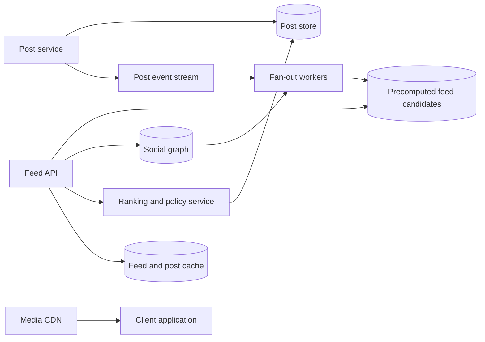

# 10. News Feed

**Difficulty:** Hard | **Key concepts:** fan-out on write/read, ranking, freshness, pagination, celebrity accounts | **Related LeetCode:** No directly related problem in the current repository.

## 1. Requirements

### Functional

- Let users publish posts and follow or unfollow other users.
- Return a personalized, ranked feed with cursor-based pagination.
- Include post text and media references without copying large media blobs.
- Reflect deletes and privacy changes in a bounded time.
- Support muted accounts, blocks, and audience visibility.
- Provide a reasonable feed when ranking features are unavailable.

### Non-functional

- Serve 200 million daily active users with p99 feed latency below 300 ms.
- Keep new posts visible to ordinary followers within seconds.
- Support very large accounts without making their writes synchronous to all followers.
- Preserve authorization after post deletion or follower changes.
- Isolate feed generation from media delivery and recommendation computation.

### Out of scope

- Building the full recommendation model or media transcoding pipeline.
- Guaranteeing a globally chronological order across regions.
- Showing every possible post from every followed account.

## 2. Back-of-the-envelope estimates

### Assumptions

- 200 million daily active users open the feed 20 times per day.
- 50 million posts are created per day.
- Each post has 200 followers on average, with a heavy-tailed distribution.
- A feed page returns 20 post IDs and compact ranking metadata.
- Keep feed entries for 30 days and posts for five years.
- Peak load is ten times the average.

### Request and fan-out volume

- Feed page reads: `200M × 20 = 4B/day`, or about 46,300 QPS average.
- Peak feed reads approach 463,000 QPS.
- Post writes: `50M / 86,400 ≈ 579/s` average, about 5,800/s peak.
- Naive fan-out: `50M × 200 = 10B feed edges/day`.
- The mean hides celebrity accounts with millions of followers.
- Use a hybrid fan-out strategy rather than unconditional per-follower writes.

### Storage and bandwidth

- A 20-ID page at 16 bytes per ID is about 320 bytes before payload hydration.
- At 463K peak reads/s, that compact page stream is about 148 MB/s.
- Thirty days of average 20-item feed windows is not the same as durable post storage.
- Five years of 50M posts/day at 1 KB metadata is about 91 TB raw.
- Three copies plus indexes require several hundred TB; media lives in object storage/CDN.
- Feed-entry retention is bounded and can be recomputed for older pages.

### Five-year footprint, traffic, and cache check

- The modeled feed read-to-post-write ratio is `4B / 50M = 80:1`.
- Five-year post metadata is `50M × 1,825 × 1 KB ≈ 91 TB` raw, before indexes and replicas.
- Retaining 30 days of 10B daily feed edges at 16 bytes each is about 4.8 TB raw.
- Peak compact feed-ID bandwidth is `463K × 320 bytes ≈ 148 MB/s`.
- Cache first pages for 200M active users at 20 IDs × 16 bytes is about 64 GB per copy.
- Three regional copies of those first-page IDs use about 192 GB before hydrated post metadata.

## 3. API design

### Read feed

- `GET /v1/feed?cursor=...&limit=20`
- Response contains ordered post IDs, rank scores, and an opaque next cursor.
- Cursor captures a stable time boundary and tie-breaker to avoid duplicates.
- Enforce `1 <= limit <= 100`.

### Publish and social graph

- `POST /v1/posts` creates a post with visibility and media references.
- `DELETE /v1/posts/{id}` tombstones the post and emits invalidation.
- `POST /v1/users/{id}/follow` and `/unfollow` update graph edges idempotently.
- Return a post version and event ID for downstream fan-out.

### Feed controls

- `POST /v1/feed/hide` records a per-user suppression.
- `GET /v1/feed?refresh=true` may request a bounded fresh merge.
- Keep client-provided ranking or cursor state untrusted and validate it server-side.

## 4. Data model

### Core records

| Entity | Key | Contents |
| --- | --- | --- |
| Post | `post_id` | Author, timestamp, content pointer, audience, version |
| Follow edge | `(follower_id, followed_id)` | Status and creation timestamp |
| Author posts | `(author_id, time, post_id)` | Reverse chronological post IDs |
| User feed | `(user_id, bucket, rank_key)` | Candidate post IDs and ranking features |
| Suppression | `(user_id, post_id)` | Hide, block, or report state |

- Store graph edges for both followers-by-author and follows-by-user traversal.
- Post metadata is durable; feed candidates are derived and rebuildable.
- Use a tombstone plus version for deletes and visibility changes.
- Store ranking features separately so model updates do not rewrite post bodies.
- Partition feed records by user and time bucket to support bounded retention.

### Storage choice

- SQL or a graph-capable store can own membership and post authorization with transactional updates.
- A partitioned NoSQL feed index fits per-user ordered candidates; derived rows can be rebuilt.

## 5. High-level architecture

- A post event triggers asynchronous fan-out for ordinary-sized audiences.
- Feed reads merge precomputed candidates with recent high-follower posts.
- Ranking applies freshness, relevance, safety, and follow graph constraints.
- Hydration fetches post metadata in batches after candidate selection.
- Media is referenced by URL and delivered by a separate CDN path.

## 6. Deep dives

### Fan-out on write versus read

- Fan-out on write makes feed reads fast but multiplies post-write work by followers.
- Fan-out on read stores fewer edges but makes every feed request query many authors.
- Use write fan-out for ordinary accounts with bounded follower counts.
- Use read-time injection for celebrities and other high-fan-out accounts.
- Choose the cutoff from observed queue cost and read fan-in, not a fixed folklore value.
- Batch feed-edge writes and retain idempotent event IDs.

### Ranking and pagination

- Candidate generation and ranking are separate so recall can be tuned independently.
- Apply authorization, blocks, and deletion filters before ranking output.
- Use a deterministic tie-breaker such as `(score, timestamp, post_id)`.
- Cursor pagination must pin a time boundary and ranking snapshot or tolerate limited movement.
- Cache first-page candidates briefly; deeper pages can use a lower freshness target.
- Keep a chronological fallback when the ranking service is unavailable.

### Privacy and deletion

- Recheck post audience during hydration; a stale feed edge is not authorization.
- Post deletion creates a tombstone consumed by caches and fan-out workers.
- Unfollow removes or filters the author's posts within a stated propagation SLO.
- A blocked author must be suppressed even if older candidate edges remain.
- Deletion workflows cover feeds, caches, search indexes, and media references.

## 7. Scaling, bottlenecks & failure modes

- Partition feeds by user; shard the largest tenants or celebrity edges separately.
- Batch hydration and use caches for common post metadata.
- A fan-out backlog causes stale feeds; monitor oldest event age and drain time.
- If a ranking model is slow, return cached candidates with simpler scoring.
- If the graph store is unavailable, use a short-lived graph snapshot with explicit staleness.
- Celebrity post storms require read-time injection and bounded candidate counts.
- Feed cache misses can overload graph and post stores; apply request coalescing.
- Rebuild derived feed edges from post stream and graph snapshots after data loss.
- Cap feed depth and expire old candidate rows to bound storage.
- Backpressure low-priority recommendations before delaying core chronological posts.

## 8. Trade-offs summary

| Decision | Chosen | Alternative | Why |
| --- | --- | --- | --- |
| Fan-out | Hybrid write/read | All write or all read | Balances ordinary feed latency and celebrity cost |
| Ranking | Asynchronous candidates plus bounded ranker | Full online retrieval per request | Keeps p99 predictable |
| Feed state | Derived and rebuildable | Source of truth | Reduces coupling to post writes |
| Pagination | Opaque stable cursor | Offset | Avoids growing scans and page drift |
| Authorization | Recheck on hydration | Trust feed edge | Prevents stale copies from exposing private posts |

## 9. Interview follow-ups

- **How do celebrity posts work?** Inject them at read time or use a hybrid threshold.
- **Can the feed be strongly consistent?** Not globally at this scale; define freshness and deletion bounds.
- **How do you avoid duplicate posts between pages?** Use a stable cursor tuple and client dedupe.
- **What if ranking fails?** Return chronological or cached candidates with safety filters intact.
- **How do you handle a follow/unfollow race?** Version graph changes and filter candidates at read time.
- **How are feed entries recovered?** Rebuild from post events and graph state because they are derived.
- **How do you personalize without excessive latency?** Precompute compact features and cap online model work.

## 10. Video & further reading

- [YouTube search: system design news feed](https://www.youtube.com/results?search_query=system+design+news+feed)
- [TAO: Facebook's distributed data store for the social graph](https://www.usenix.org/conference/atc13/technical-sessions/presentation/bronson)
