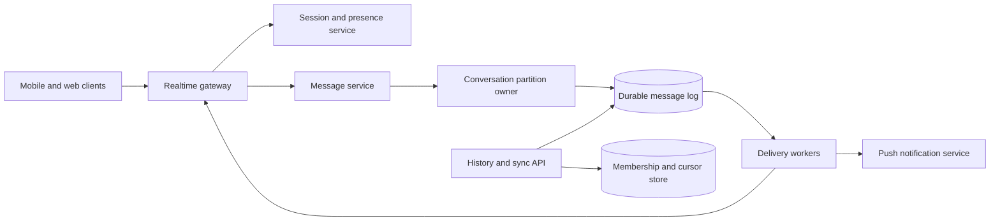

# 11. Chat System

**Difficulty:** Hard | **Key concepts:** persistent messaging, per-conversation order, WebSockets, offline sync, presence, delivery receipts | **Related LeetCode:** [Front-Middle-Back Queue](../../design/1670-design-front-middle-back-queue-medium/README.md)

## 1. Requirements

### Functional

- Support one-to-one and group conversations with membership controls.
- Send, persist, and retrieve messages in conversation order.
- Deliver to connected clients and synchronize offline devices later.
- Support acknowledgements, read cursors, and bounded edit/delete operations.
- Expose online presence as a best-effort signal.
- Notify users of unread messages without blocking message persistence.

### Non-functional

- Sustain 100 million daily active users and 50 messages per user per day.
- Keep message-send acknowledgement below 100 ms at p99 in-region.
- Preserve accepted messages through a single node or zone failure.
- Maintain ordering within one conversation, not a global total order.
- Support multi-device delivery and resumable synchronization.
- Limit fan-out cost for large groups and high-volume public channels.

### Out of scope

- End-to-end encryption key exchange and media processing details.
- Guaranteed presence accuracy during network partitions.
- Arbitrary public-channel search over message content.

## 2. Back-of-the-envelope estimates

### Assumptions

- 100 million daily active users send 50 messages per day each.
- Average persisted message, headers, and index entry total 1 KB.
- Retain messages for 30 days in the primary tier.
- Peak traffic is ten times the daily average.
- Average group size is 8; a small long tail has much larger rooms.

### Request volume

- Messages per day: `100M × 50 = 5B`.
- Average message-send QPS: `5B / 86,400 ≈ 57,870`.
- Peak message-send QPS: about 579,000.
- Delivery fan-out at average group size 8 is about 463,000 recipient-delivery QPS.
- Typing indicators and presence heartbeats are separate, lossy traffic classes.

### Storage and bandwidth

- One day raw message data: `5B × 1 KB ≈ 5 TB`.
- Thirty-day raw retention: about 150 TB; three replicas require 450 TB.
- Compaction, indexes, media references, and backups add further headroom.
- At 1 KB per message, peak inbound payload is about 579 MB/s.
- Store media in object storage and put only references in message records.
- Use hot/warm retention tiers when older history is read less frequently.

### Five-year footprint, traffic, and cache check

- Assume message history reads average five per send, a `5:1` read-to-write ratio.
- Five-year log volume at 5B messages/day and 1 KB each is `5B × 1,825 × 1 KB ≈ 9.1 PB` raw.
- Three copies of that full history would require about 27.4 PB; the working tier retains only 30 days.
- Peak inbound message bandwidth is about 579 MB/s; four-recipient fan-out can add roughly 2.3 GB/s egress.
- Cache the latest 50 messages for 2M active conversations at 1 KB each: about 100 GB.
- Keep presence state separately sized from the short-lived device session count.

## 3. API design

### Send

- WebSocket frame or `POST /v1/conversations/{id}/messages`.
- Request carries `clientMessageId`, body, optional reply reference, and device ID.
- Response returns server message ID, conversation sequence, and accepted timestamp.
- Idempotency key is scoped to `(sender_id, clientMessageId)`.

### Sync and acknowledgement

- `GET /v1/conversations/{id}/messages?afterSequence=...&limit=...`.
- `POST /v1/conversations/{id}/ack` advances delivered or read sequence.
- `GET /v1/sync?cursor=...` returns conversation and membership changes.
- WebSocket reconnect supplies last acknowledged sequence per active conversation.

### Conversation controls

- `POST /v1/conversations` creates membership and settings.
- `POST /v1/conversations/{id}/members` adds a member with an authorization check.
- `DELETE /v1/conversations/{id}/members/{userId}` revokes access.
- Membership changes have a monotonically increasing version.

## 4. Data model

### Message and membership

| Entity | Key | Contents |
| --- | --- | --- |
| Conversation | `conversation_id` | Type, creator, membership version |
| Message | `(conversation_id, sequence)` | Sender, body reference, timestamp, state |
| Membership | `(conversation_id, user_id)` | Role, join sequence, leave time |
| User cursor | `(user_id, conversation_id)` | Delivered and read sequence |
| Device session | `(user_id, device_id)` | Connection, expiry, last sync cursor |

- Allocate sequence numbers per conversation through a partition owner.
- Partition message storage by conversation and sequence range.
- Keep a separate inbox index for unread conversation summaries.
- Store membership history or audit events for authorization and dispute handling.
- Expire presence leases quickly; presence is derived state, not a durable truth.

### Storage choice

- A partitioned append-log or NoSQL store fits ordered message history and high write volume.
- SQL is appropriate for membership and permission changes that need transactional constraints.

## 5. High-level architecture

- Realtime gateways terminate client connections and maintain short-lived sessions.
- Message service authenticates sender and checks current membership.
- A conversation partition owner assigns a sequence and appends durably.
- Delivery workers fan out to active devices and create offline notifications.
- Sync APIs use sequence cursors to recover messages missed during disconnects.

## 6. Deep dives

### Ordering and persistence

- Ordering is required within a conversation, not across the whole fleet.
- A partition owner sequences messages for one conversation and appends to a durable log.
- The server acknowledgement follows the required replication quorum.
- Retries reuse `clientMessageId` so an ambiguous network timeout does not create duplicates.
- Partition movement transfers the last committed sequence and fences the old owner.
- If a single large room exceeds one partition, define whether weaker order is acceptable.

### Delivery and offline sync

- Persist first, then fan out; delivery failure must not erase the message.
- A connected gateway receives a message only after its conversation sequence is committed.
- Per-device cursors allow multiple devices to catch up independently.
- Push notifications are wake-up hints and should not contain sensitive content by default.
- A reconnect can request all messages after its last cursor, then advance acknowledgement.
- Deduplicate client display by server message ID and sequence.

### Presence and large groups

- Gateways renew short leases for each active user/device.
- Presence transitions can be delayed or missed; expose them as approximate.
- Do not send every typing signal to every member of a large room.
- Batch group fan-out and prioritize direct messages above low-value presence traffic.
- Store conversation membership separately from online session state.

## 7. Scaling, bottlenecks & failure modes

- Partition by conversation ID and distribute high-volume rooms explicitly.
- A hot group can saturate one sequencer; move it to a dedicated partition.
- If a gateway dies, clients reconnect and replay from their acknowledged cursors.
- If push delivery fails, the message remains available to sync on next app open.
- Membership revocation must invalidate caches before future reads are served.
- Queue lag should be measured as age of the oldest undelivered sequence.
- Backpressure typing indicators and presence before rejecting durable messages.
- Keep per-user connection limits to prevent resource exhaustion.
- Apply retention and legal hold policies at the message-record level.
- Do not claim exact read receipts if clients can remain offline.

## 8. Trade-offs summary

| Decision | Chosen | Alternative | Why |
| --- | --- | --- | --- |
| Ordering | Per-conversation sequence | Global order | Scales without a fleet-wide sequencer |
| Delivery | Persist then asynchronous fan-out | Push before durable write | A gateway failure cannot lose an acknowledged message |
| Offline sync | Cursor-based log read | Push-only delivery | Reconnect can repair missed messages |
| Presence | Expiring leases | Durable online flag | Crashed clients eventually disappear |
| Group fan-out | Batched asynchronous workers | Synchronous loop in sender request | Send latency does not scale with group size |

## 9. Interview follow-ups

- **How do you guarantee order?** Assign sequence numbers at one partition owner per conversation.
- **What if the sender retries?** Deduplicate by a sender-generated client message ID.
- **How do offline devices catch up?** Fetch after their last durable per-conversation cursor.
- **Can read receipts be exact?** They report client acknowledgements, not human attention.
- **How do large groups scale?** Batch delivery, isolate hot rooms, and define ordering scope explicitly.
- **How are revoked members handled?** Version membership and recheck it on history reads.
- **What if a region fails?** Fail over the conversation partition with fencing and a replicated log.

## 10. Video & further reading

- [YouTube search: system design chat system](https://www.youtube.com/results?search_query=system+design+chat+system)
- [WhatsApp architecture overview](https://www.infoq.com/presentations/whatsapp-erlang/)
