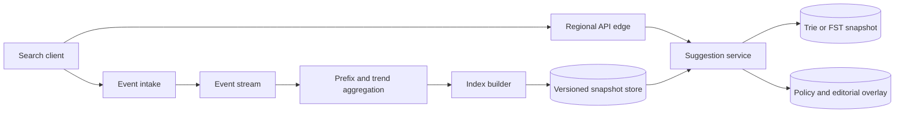

# 12. Search Autocomplete

**Difficulty:** Medium | **Key concepts:** prefix index, top-k ranking, freshness, privacy filtering, snapshots | **Related LeetCode:** [Implement Trie II](../../design/1804-implement-trie-ii-prefix-tree-medium/README.md)

## 1. Requirements

### Functional

- Return a small ranked suggestion list as a user types a prefix.
- Support a configurable locale, category, and optional user context.
- Combine popular queries with recent trends and editorial suggestions.
- Remove unsafe or suppressed suggestions quickly.
- Accept query events for popularity and trend computation.
- Provide a fallback list when personalization is unavailable.

### Non-functional

- Serve 50 million daily active users with p99 latency below 50 ms.
- Return suggestions for a prefix with at most 10 results.
- Keep privacy filters and abuse suppression stronger than ranking freshness.
- Publish a new index snapshot without interrupting reads.
- Bound memory per shard and avoid scanning the full query corpus.

### Out of scope

- Executing the final search or ranking full result documents.
- Inferring sensitive traits from a user's typed prefix.
- Guaranteeing every new query is immediately visible.

## 2. Back-of-the-envelope estimates

### Assumptions

- 50 million daily active users issue ten search sessions per day.
- A session sends eight prefix requests on average.
- The index contains 100 million normalized query phrases.
- Each response contains ten suggestions averaging 100 bytes each.
- Peak traffic is ten times the average.
- Keep 30 days of raw query events for trend computation.

### Request volume

- Prefix requests per day: `50M × 10 × 8 = 4B`.
- Average autocomplete QPS: `4B / 86,400 ≈ 46,300`.
- Peak QPS: about 463,000.
- Peak response bandwidth at ten 80-byte suggestions is about `463K × 800 bytes ≈ 370 MB/s`.
- Debouncing on the client can cut redundant prefixes but cannot be assumed for capacity.

### Index and event storage

- At 80 bytes per phrase and metadata, raw phrase index is about 8 GB.
- Trie pointers and ranking lists may multiply this; budget 30–60 GB per locale.
- Thirty-day events at 100 bytes each and 500M daily searches need about 1.5 TB raw.
- Aggregate events into prefix and phrase counters before long-term retention.
- Keep multiple index snapshots during rolling publication.

### Five-year footprint, traffic, and cache check

- Prefix queries outnumber index phrase changes by an assumed `8:1` over the active corpus.
- Five-year raw event volume at 500M events/day and 100 bytes is `500M × 1,825 × 100 bytes ≈ 91 TB`.
- The rebuilt phrase index remains about 30–60 GB per locale, independent of event-log retention.
- Peak response egress is `463K × 10 × 80 bytes ≈ 370 MB/s`.
- Cache the top ten results for one million hot prefixes at 100 bytes each in about 1 GB.
- Retain a separate small suppression overlay so cache entries cannot outlive policy.

## 3. API design

### Suggest

- `GET /v1/suggest?q=...&locale=en-US&limit=10&context=...`
- Response includes suggestion text, type, rank metadata, and snapshot version.
- Return a stable request ID for tracing but avoid echoing raw user identifiers.
- `limit` is capped at 10; very short prefixes may return an empty result.

### Event ingestion

- `POST /v1/search-events` accepts query, locale, timestamp, and consent flags.
- Batch events and sample low-value repeated prefixes.
- Strip or hash user identifiers before aggregation.
- Reject malformed or overlong events at intake.

### Editorial control

- `PUT /v1/suggestions/{id}` creates or changes a curated suggestion.
- `DELETE /v1/suggestions/{id}` publishes a suppression tombstone.
- Every change carries locale, validity interval, author, and audit reason.

## 4. Data model

### Index entry

| Field | Type | Purpose |
| --- | --- | --- |
| `normalized_phrase` | string | Prefix lookup key |
| `display_phrase` | string | User-facing suggestion |
| `locale` | compact code | Locale-specific tokenization |
| `popularity` | decayed score | Historical ranking signal |
| `trend_score` | time-bucketed score | Short-lived emerging interest |
| `policy_state` | enum | Allowed, suppressed, or editorial |

- Build immutable, locale-partitioned trie or finite-state index snapshots.
- Store top candidates at selected prefix nodes to bound lookup work.
- Keep ranking features compact and normalized before distributing snapshots.
- Store query events in time partitions with retention and consent metadata.
- Use a denylist overlay so safety removals do not wait for full index rebuild.

### Storage choice

- Build an immutable trie/FST snapshot for prefix serving; a relational prefix scan is too costly at this QPS.
- Store editorial controls and suppression records in SQL for audit, then publish a compact read overlay.

## 5. High-level architecture

- The edge validates prefix length, locale, and request budget.
- Suggestion workers query an in-memory immutable snapshot.
- A small overlay applies current suppressions and curated entries.
- Event workers aggregate popularity and trends in time buckets.
- Builders publish a versioned snapshot, then workers switch atomically.

## 6. Deep dives

### Prefix index and ranking

- A trie provides prefix traversal but can use substantial pointer memory.
- A compressed trie or finite-state transducer reduces repeated suffix storage.
- Store only a bounded top-k candidate list at common prefixes.
- For rare prefixes, traverse a small subtree and rank its matching phrases.
- Combine decayed popularity, freshness, locale, and editorial boosts.
- Do not let one short prefix produce an unbounded candidate scan.

### Freshness and publication

- Aggregate events continuously, but rebuild expensive snapshots in batches.
- Use streaming counters for trending phrases with decay and minimum sample thresholds.
- Publish to a new snapshot version, warm workers, then atomically switch reads.
- Keep the previous snapshot for fast rollback.
- A denylist overlay takes precedence over all cached ranking results.

### Privacy and abuse controls

- Prefixes can reveal sensitive intent; minimize raw event retention.
- Filter unsafe, personally identifying, and policy-blocked terms.
- Protect against query injection by treating all prefixes as data.
- Rate-limit automated scraping and apply per-client budgets.
- Do not personalize from sensitive categories without explicit product approval.

## 7. Scaling, bottlenecks & failure modes

- Shard snapshots by locale or first normalized characters.
- Replicate hot locales across regions and keep snapshots in memory.
- Very common short prefixes may be hot; cache their final ranked list briefly.
- If event aggregation lags, serve the last good snapshot and expose its age.
- If a builder emits a bad snapshot, validate counts and policy coverage before switching.
- If personalization fails, fall back to global locale ranking.
- Avoid returning stale suggestions that have been suppressed in the overlay.
- Use atomic snapshot swaps to avoid partial indexes during worker refresh.
- Bound prefix length, query rate, and result count to control CPU.
- Monitor latency and index age by locale, not only globally.

## 8. Trade-offs summary

| Decision | Chosen | Alternative | Why |
| --- | --- | --- | --- |
| Index | Compressed immutable trie/FST | Database prefix scan | Predictable lookup latency at high QPS |
| Updates | Snapshot rebuild plus overlay | Mutate every trie node online | Safer publication and rollback |
| Ranking | Popularity plus trend decay | Raw frequency only | Avoids permanently stale popularity |
| Personalization | Optional bounded signal | Per-user custom index | Controls cost and sensitive-data exposure |
| Safety | Immediate suppression overlay | Wait for next rebuild | Fast policy response |

## 9. Interview follow-ups

- **How are new trends surfaced?** Aggregate recent events with decay and a minimum count.
- **Why not query a relational database?** Prefix scans and ranking would not meet high-QPS latency targets.
- **How do you remove a bad suggestion quickly?** A versioned deny overlay filters it before ranking results are returned.
- **How do you handle typo prefixes?** Add a bounded fuzzy fallback only after exact prefix lookup.
- **How do you limit short-prefix cost?** Precompute top candidates and cap traversal work.
- **What if a snapshot is corrupt?** Validate before activation and retain the previous version for rollback.
- **How do privacy rules affect analytics?** Enforce consent and retention before aggregate pipelines store events.

## 10. Video & further reading

- [YouTube search: system design search autocomplete](https://www.youtube.com/results?search_query=system+design+search+autocomplete)
- [Lucene FST documentation](https://lucene.apache.org/core/9_10_0/core/org/apache/lucene/util/fst/package-summary.html)
