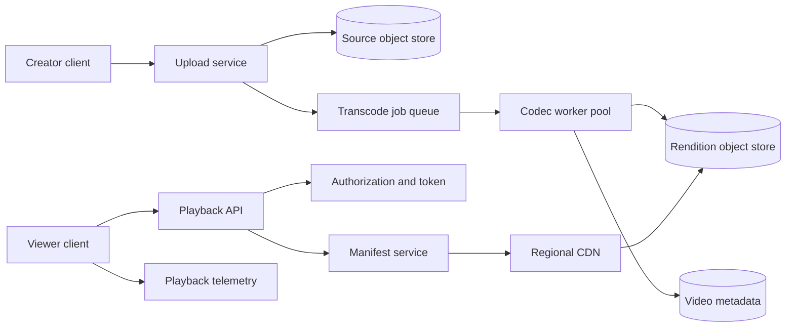

# 13. Video Streaming

**Difficulty:** Hard | **Key concepts:** ingest, transcoding, adaptive bitrate, manifests, CDN, playback analytics | **Related LeetCode:** [Design Video Sharing Platform](../../design/2254-design-video-sharing-platform-hard/README.md)

## 1. Requirements

### Functional

- Let creators upload video and attach title, privacy, and publishing metadata.
- Transcode source media into multiple codecs, resolutions, and bitrates.
- Serve adaptive playback to web, mobile, and connected-TV clients.
- Support pause/resume, seeking, captions, and access-controlled playback.
- Publish videos only after required renditions and metadata are ready.
- Collect playback start, buffering, completion, and quality events.

### Non-functional

- Support 100 million daily viewers and high traffic skew toward popular videos.
- Start playback within two seconds at p95 on a healthy broadband connection.
- Keep playback available during regional or transcoder failures.
- Deliver media near users while limiting origin egress cost.
- Preserve upload integrity and prevent unauthorized access to private videos.

### Out of scope

- Live streaming, real-time conferencing, and rights licensing details.
- Building a recommendation system or social graph.
- Guaranteeing identical quality across every device and network.

## 2. Back-of-the-envelope estimates

### Assumptions

- 100 million daily active viewers watch five videos each per day.
- Average watch duration is ten minutes at 2 Mbps.
- Media is delivered in average six-second segments.
- A creator upload averages 200 MB before encoding.
- Peak playback concurrency is 5 million viewers.
- CDN cache hit ratio is 95% for bytes served.

### Playback and storage

- Daily watch time: `100M × 5 × 10 min = 5B minutes`.
- Average segment-request QPS is `500M plays × 100 segments / 86,400 ≈ 579K`.
- At 5M concurrent viewers, six-second segments imply a peak of `5M / 6 ≈ 833K` segment QPS.
- Daily delivered bytes: `5B × 60 × 2 Mbps / 8 ≈ 75 PB`.
- Average delivery bandwidth is about `75 PB / 86,400 ≈ 0.87 TB/s`.
- At 5M concurrent viewers and 2 Mbps, peak delivery bandwidth is 10 Tbps.
- 95% CDN hit rate leaves about 0.5 Tbps of origin bandwidth at peak.
- One million new 200 MB uploads/day is 200 PB/day before renditions.

### Encoding capacity

- Assume 1M uploads/day and 20 minutes average processing per upload.
- Required average worker concurrency: `1M × 20 / 1,440 ≈ 13,900`.
- Peak and codec-specific queues need additional headroom and priority scheduling.
- Store source plus generated renditions according to retention policy.
- Media dominates storage; metadata and manifests are comparatively small.

### Five-year footprint, traffic, and cache check

- The assumed playback-to-upload ratio is `500M plays / 1M uploads = 500:1`.
- Five-year source-media storage is `1M × 1,825 × 200 MB ≈ 365 PB` before renditions.
- If encoded renditions average three times source size, total new media approaches 1.46 EB.
- Peak viewer egress is `5M × 2 Mbps = 10 Tbps`; the 95% CDN hit target leaves 0.5 Tbps at origin.
- A regional edge cache holding 1,000 hot titles at 10 GB each needs about 10 TB.
- Keep manifests and authorization metadata in a separate, much smaller cache.

## 3. API design

### Upload

- `POST /v1/videos/uploads` creates a resumable upload session.
- `PUT /v1/uploads/{sessionId}/parts/{partNumber}` uploads checksummed chunks.
- `POST /v1/uploads/{sessionId}/complete` verifies parts and starts processing.
- Response includes video ID, processing state, and retryable upload URLs.

### Playback

- `GET /v1/videos/{videoId}/playback` returns an authorized manifest URL.
- `GET /v1/videos/{videoId}` returns metadata and publication state.
- Playback tokens are short-lived and scoped to a video and viewer.
- Support byte-range requests only for formats and clients that need them.

### Creator operations

- `PATCH /v1/videos/{videoId}` updates title, visibility, or captions.
- `DELETE /v1/videos/{videoId}` tombstones metadata and schedules media cleanup.
- Return processing state transitions rather than a generic success boolean.

## 4. Data model

### Video and rendition

| Entity | Key | Contents |
| --- | --- | --- |
| Video | `video_id` | Owner, title, visibility, state, source key |
| Rendition | `(video_id, profile)` | Codec, bitrate, resolution, playlist key |
| Segment | `(rendition_id, sequence)` | Object key, duration, checksum |
| Upload session | `session_id` | Parts, expiry, owner, received bytes |
| Playback event | `event_id` | Video, rendition, timestamp, QoE fields |

- Store media segments in object storage with immutable content-addressed keys.
- Partition video metadata by `video_id`; segment objects use immutable content-addressed keys.
- Keep metadata in a transactional database to coordinate publication state.
- The manifest references only complete, verified segments.
- Keep per-user authorization outside the public CDN cache key.
- Aggregate playback telemetry separately from raw video objects.

### Storage choice

- SQL metadata transactions coordinate ownership and publication state; immutable video bytes belong in object storage.
- A NoSQL rendition catalog can scale direct metadata reads, but it must preserve versioned publication semantics.

## 5. High-level architecture

- Upload service writes resumable source chunks and verifies final checksum.
- A durable job queue schedules encoding by codec and priority.
- Workers publish renditions only after segment checks and manifest validation.
- Playback API authenticates and returns a short-lived CDN capability.
- QoE events flow asynchronously and do not block video playback.

## 6. Deep dives

### Adaptive bitrate and packaging

- Encode a ladder of profiles based on source resolution and device support.
- Segment each rendition into aligned time windows for smooth switching.
- A manifest advertises available bitrates and segment URLs.
- The player selects bitrate from throughput, buffer depth, and device limits.
- Avoid generating profiles above the source quality.
- Support a default codec and optional newer codecs based on client capability.
- Captions and audio tracks are referenced as separate manifest resources.

### Transcoding workflow

- Jobs are idempotent by `(video_id, source_version, profile)`.
- Publish the video only after required profiles complete or policy allows partial readiness.
- A worker crash retries the profile without duplicating visible renditions.
- Check checksums and duration at each pipeline stage.
- Separate CPU-heavy encoding from GPU-accelerated or specialized codec queues.
- Keep the original source for later re-encoding if retention permits.

### CDN delivery and authorization

- Cache immutable segments with long-lived URLs and content hashes.
- Keep manifests short-lived when visibility or rendition state can change.
- A signed token authorizes the video without putting user identity in cache keys.
- CDN purge is a fallback; versioned URLs make most invalidation unnecessary.
- Restrict origin access so clients cannot bypass CDN controls.

## 7. Scaling, bottlenecks & failure modes

- Place popular content in multiple CDN regions and prewarm on expected releases.
- A viral upload can create a hot origin object; cache shielding and request collapsing protect storage.
- If an encoding profile fails, publish available lower renditions when policy allows.
- If the CDN is degraded, route to another provider or regional origin with bounded egress.
- Upload retries use part checksums and session expiry to avoid duplicate source copies.
- Transcoder backlog needs age-based SLO alerts and creator-visible status.
- Protect metadata from being marked published before objects are replicated.
- Delete workflows revoke playback tokens and asynchronously remove all renditions.
- Use per-account upload quotas and malware/content safety checks.
- Monitor startup delay, rebuffer ratio, bitrate switches, and playback completion by region.

## 8. Trade-offs summary

| Decision | Chosen | Alternative | Why |
| --- | --- | --- | --- |
| Packaging | Segmented adaptive bitrate | One fixed MP4 | Supports network and device variation |
| Storage | Immutable object segments | Database blobs | Scales byte volume independently |
| Processing | Asynchronous jobs | Encode in upload request | Upload latency is not tied to transcode time |
| CDN keys | Versioned immutable segments | Purge each segment on edits | Avoids broad invalidation for media objects |
| Publication | Required-rendition gate | Publish immediately | Prevents clients receiving incomplete manifests |

## 9. Interview follow-ups

- **How does playback start quickly?** Return a small manifest and serve the first segment from a nearby CDN.
- **What if only some renditions finish?** Publish a policy-approved subset and continue background encoding.
- **How are edits handled?** Create a new source version and immutable rendition keys.
- **How do private videos use a CDN?** Use short-lived signed URLs or cookies with edge authorization.
- **How is origin egress controlled?** Cache shielding, regional replication, and byte-based budgets.
- **What if a CDN serves a deleted video?** Revoke tokens, version manifests, and purge as a secondary safeguard.
- **How are quality problems detected?** Aggregate startup, rebuffer, and bitrate telemetry by client cohort.

## 10. Video & further reading

- [YouTube search: system design video streaming](https://www.youtube.com/results?search_query=system+design+video+streaming)
- [Apple HTTP Live Streaming documentation](https://developer.apple.com/streaming/)
