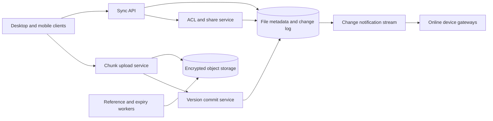

# 14. File Storage and Sync

**Difficulty:** Hard | **Key concepts:** chunking, content hashes, versions, delta sync, conflict handling, sharing | **Related LeetCode:** [Design In-Memory File System](../../design/0588-design-in-memory-file-system-hard/README.md), [Design File Sharing System](../../design/1500-design-a-file-sharing-system-medium/README.md)

## 1. Requirements

### Functional

- Upload, download, rename, move, and delete files and folders.
- Sync changes across a user's devices with resumable cursors.
- Support sharing links and access revocation.
- Upload large files in chunks and resume after network interruption.
- Detect concurrent edits and preserve or resolve versions explicitly.
- Provide a user-visible conflict copy rather than silently lose data.

### Non-functional

- Support 20 million daily active users and reliable background sync.
- A small file change should propagate within seconds in a healthy region.
- A file must not become visible before all referenced chunks are durable.
- Preserve access controls across device sync and shared links.
- Scale storage independently from metadata and notification fan-out.

### Out of scope

- Real-time collaborative editing of one document.
- Full backup of arbitrary operating-system state.
- Malware scanning and legal compliance policy details.

## 2. Back-of-the-envelope estimates

### Assumptions

- 20 million daily active users make two file changes per day.
- There are 40 million new file versions/day, averaging 2 MB each.
- Use 4 MB fixed-size chunks with content hashes.
- Retain active and historical versions for 30 days in the working estimate.
- Metadata per version and chunk map averages 2 KB.
- Peak sync requests are ten times average.

### Request and storage volume

- Average metadata-write QPS: `40M / 86,400 ≈ 463`.
- Peak metadata-write QPS: about 4,630, plus chunk upload traffic.
- With a 5:1 read-to-write ratio, average metadata-read QPS is about 2,315 and total API load is about 2,778 QPS.
- New raw data: `40M × 2 MB = 80 TB/day`.
- Thirty-day raw version storage: `80 TB × 30 = 2.4 PB`.
- Three copies require 7.2 PB before deduplication and lifecycle tiers.
- Version metadata is `40M × 2 KB = 80 GB/day`.

### Network and chunking

- Average upload bandwidth is `80 TB / 86,400 ≈ 926 MB/s` before compression.
- Client-side delta encoding can reduce repeated content but cannot be guaranteed.
- A 2 MB file maps to one chunk on average; large files map to multiple chunks.
- A 4 MB chunk hash index for 2.4 PB spans roughly 600 million chunk references.
- Keep transfer bandwidth separate from metadata API capacity planning.

### Five-year footprint, traffic, and cache check

- Assume reads and sync downloads outnumber file-version commits by `5:1`.
- Five-year version storage at 40M versions/day and 2 MB each is `40M × 1,825 × 2 MB ≈ 146 PB` raw.
- Three copies of that full history would exceed 438 PB; lifecycle retention and chunk deduplication are key cost controls.
- Mean upload payload bandwidth is about 926 MB/s before client-side deltas.
- A hot chunk cache of one million 4 MB chunks needs about 4 TB across the fleet.
- Cache file-tree metadata and ACLs separately, with version-based invalidation.

## 3. API design

### Change discovery

- `GET /v1/sync?cursor=...&limit=...` returns ordered metadata changes.
- Cursor is opaque, scoped to the account, and safe to retry.
- Response includes file ID, version, operation, parent, and ACL version.
- A full resync endpoint returns a snapshot token and paginated tree listing.

### Upload and commit

- `POST /v1/files/{id}/upload-session` begins a versioned upload.
- `PUT /v1/upload-sessions/{session}/chunks/{index}` uploads content-addressed parts.
- `POST /v1/upload-sessions/{session}/commit` supplies the chunk manifest and base version.
- Server verifies all required chunks before publishing the new file version.
- Idempotency keys make chunk and commit retries safe.

### Download and share

- `GET /v1/files/{id}/versions/{version}/download` returns a short-lived object URL.
- `POST /v1/shares` creates a scoped permission or expiring link.
- `DELETE /v1/shares/{shareId}` revokes access and invalidates authorization caches.
- Range downloads support clients that need partial recovery.

## 4. Data model

### Metadata and chunks

| Entity | Key | Contents |
| --- | --- | --- |
| File node | `file_id` | Owner, parent, name, type, current version |
| File version | `(file_id, version)` | Size, modified time, chunk manifest, checksum |
| Chunk | `content_hash` | Object key, size, encryption metadata |
| Change log | `(account_id, sequence)` | Operation, affected IDs, ACL version |
| Share grant | `share_id` | Scope, principal, expiry, permission |

- Store large chunk bytes in object storage under immutable keys.
- Keep file tree and version metadata in a transactional database.
- Use an account sequence to order sync changes for one user's tree.
- Partition file metadata by account and chunk objects by content hash to localize sync and deduplication.
- Deduplicate chunks only within a privacy boundary; global dedupe can leak file existence.
- Retain chunk references until every live file version releases them.

### Storage choice

- SQL is suitable for file-tree metadata, ACLs, and conditional version commits.
- NoSQL or object storage fits immutable chunks and high-throughput content reads; chunks are not joined relationally.

## 5. High-level architecture

- Clients compare local cursors with the server change log and request deltas.
- The upload service writes immutable chunks before a version commit is visible.
- Commit verifies the base version, permissions, chunk presence, and checksum.
- Change events wake connected devices; offline clients pull when they reconnect.
- Garbage collection deletes unreferenced chunks after a safety grace period.

## 6. Deep dives

### Chunking, deduplication, and integrity

- Fixed-size chunks simplify addressing and retry; content-defined chunks improve dedupe.
- Hash each chunk and the whole file to verify transfer integrity.
- Encrypt chunks before storage and scope dedupe to avoid cross-tenant side channels.
- Reuse unchanged chunks across versions when the security model permits it.
- A manifest is committed only after all referenced objects are durable.
- Partial upload sessions expire and release temporary object references.

### Sync cursors and conflict handling

- A per-account monotonically increasing sequence gives a clear change cursor.
- Clients apply changes idempotently and persist their last applied sequence.
- If two devices upload from the same base version, reject one with a conflict response.
- Preserve both versions or create a conflict copy rather than silently overwrite.
- Renames and moves need stable file IDs so path changes do not imply new content.
- A cursor that falls outside retention triggers a full snapshot resync.

### Authorization and shares

- Check ACLs at commit, sync listing, and download; an object URL alone is not identity.
- A share token is scoped, revocable, and can expire.
- Increment ACL version on permission changes and invalidate cached decisions.
- Never expose another user's chunk hashes as a deduplication response.
- Audit shared-link access with a retention policy that avoids storing excessive PII.

## 7. Scaling, bottlenecks & failure modes

- Separate metadata partitions from object storage bandwidth and capacity.
- Hot shared folders need paginated change streams and bounded notification fan-out.
- If object storage is degraded, retain the upload session and retry chunk commits.
- If a client cursor is stale, return a clear resync-required response.
- A metadata commit must not point to missing chunks; publish after verification.
- GC lag consumes storage but should never delete chunks still referenced by a version.
- Revoke signed URLs quickly or use short TTLs when permissions change.
- Apply upload quotas, virus scanning, and file-type policy before sharing.
- Large folder moves can create many events; represent them as a versioned subtree operation.
- Monitor change-log lag, chunk retry rate, orphan bytes, and sync completion time.

## 8. Trade-offs summary

| Decision | Chosen | Alternative | Why |
| --- | --- | --- | --- |
| Content | Immutable chunks | Overwrite one whole-file object | Efficient retries, versions, and delta reuse |
| Sync | Per-account cursor log | Poll entire tree | Sends only changes and supports recovery |
| Conflict | Explicit version conflict | Last write wins | Prevents silent data loss |
| Dedupe | Privacy-scoped | Global content hash | Avoids revealing other tenants' content |
| Deletion | Reference-counted delayed GC | Immediate object delete | Active versions may still share chunks |

## 9. Interview follow-ups

- **How does a client resume a large upload?** Persist a session ID and verify each content-addressed chunk.
- **What if two devices edit offline?** Detect base-version mismatch and preserve both user changes.
- **How do you avoid a lost update?** Commit conditionally against the version observed by the client.
- **What if sync history expires?** Issue a snapshot cursor and require a full tree resync.
- **Can users share a deduplicated object directly?** Authorization remains at the metadata layer; use scoped URLs.
- **How is a deleted file recovered?** Keep version metadata and chunk references through the retention window.
- **How are chunk hashes protected?** Scope dedupe and avoid exposing hash-existence checks across tenants.

## 10. Video & further reading

- [YouTube search: system design Dropbox file sync](https://www.youtube.com/results?search_query=system+design+Dropbox+file+sync)
- [Amazon S3 multipart upload overview](https://docs.aws.amazon.com/AmazonS3/latest/userguide/mpuoverview.html)
