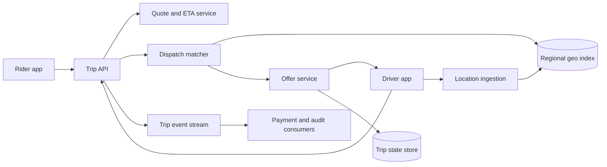

# 15. Ride Sharing

**Difficulty:** Hard | **Key concepts:** geospatial indexing, dispatch, trip state machine, pricing, location freshness | **Related LeetCode:** [Design Ride Sharing System](../../design/3829-design-ride-sharing-system-medium/README.md)

## 1. Requirements

### Functional

- Let a rider request a trip with pickup and destination coordinates.
- Find nearby eligible drivers and offer a trip with an expiry.
- Let drivers accept or reject and report location and availability.
- Track trip state from requested through pickup, completion, or cancellation.
- Show estimated fare and arrival time before acceptance.
- Keep trip history and support basic payment settlement and dispute audit.

### Non-functional

- Support 20 million daily riders and several million active drivers globally.
- Return a dispatch candidate within two seconds at p95 in a dense city.
- Keep driver location fresh enough for pickup decisions without durable writes per ping.
- Avoid assigning one driver to two concurrent trips.
- Continue core dispatch in one metro during a regional control-plane failure.

### Out of scope

- Navigation route optimization and detailed mapping data.
- Dynamic pricing policy design and fraud investigation.
- Autonomous vehicles and multi-stop pooling optimization.

## 2. Back-of-the-envelope estimates

### Assumptions

- 20 million riders request an average of two trips per day.
- 5 million drivers are active at peak.
- Each active driver sends one location update every five seconds.
- A trip request and state changes generate about 2 KB of durable metadata.
- Peak trip requests are ten times average.

### Request volume

- Trips per day: `20M × 2 = 40M`.
- Average trip-request QPS: `40M / 86,400 ≈ 463`.
- Peak trip-request QPS: about 4,630.
- Location-update QPS: `5M drivers / 5 seconds = 1M updates/s` at the assumed active fleet.
- Location events are ephemeral and should not share the trip database write path.

### Storage and bandwidth

- Thirty-day trip records: `40M × 30 × 2 KB ≈ 2.4 TB` raw.
- Three replicas require about 7.2 TB before indexes and audit history.
- Location state for 5M drivers at 128 bytes each is about 640 MB per snapshot.
- Location-update ingress bandwidth at 100 bytes/update is `1M × 100 bytes = 100 MB/s`.
- Keep only current location and a short operational trail for most drivers.
- Durable trip events and payment ledger records need separate retention.

### Five-year footprint, traffic, and cache check

- Assume nearby-driver and trip-status reads outnumber trip writes by `10:1`.
- Five-year trip metadata is `40M × 1,825 × 2 KB ≈ 146 TB` raw, before event history and replicas.
- Peak location payload bandwidth is `1M updates/s × 100 bytes ≈ 100 MB/s`.
- The current-location cache for 5M drivers at 128 bytes is about 640 MB before spatial-index overhead.
- Budget roughly 2 GB per large metro region for live locations and geo-index structures.
- Location state is ephemeral; retain only a short sampled trail for operations and safety.

## 3. API design

### Request and dispatch

- `POST /v1/trips` submits pickup, destination, rider ID, and request idempotency key.
- Response returns trip ID, quote, and matching state.
- `POST /v1/trips/{id}/offers/{offerId}:accept` conditionally reserves a driver.
- `POST /v1/trips/{id}:cancel` includes actor and reason.
- Candidate offers expire quickly; stale clients cannot accept an expired offer.

### Driver state

- `PUT /v1/drivers/{id}/location` carries coordinates, timestamp, and sequence.
- `PATCH /v1/drivers/{id}/availability` changes online or offline state.
- Location updates may be batched or streamed over a persistent connection.
- Reject old sequence numbers and implausible coordinate jumps.

### Trip lifecycle

- `POST /v1/trips/{id}/events` records pickup, arrival, completion, or cancellation.
- Each transition includes an expected current state and event id.
- Return the authoritative current state after a conditional transition.
- Do not accept payment completion as proof that a trip itself completed.

## 4. Data model

### Trip and driver state

| Entity | Key | Contents |
| --- | --- | --- |
| Trip | `trip_id` | Rider, driver, route, quote, state, timestamps |
| Driver | `driver_id` | Eligibility, vehicle class, availability |
| Driver location | `driver_id` | Geohash/cell, coordinates, timestamp, sequence |
| Offer | `offer_id` | Trip, driver, expiry, accept/reject state |
| Trip event | `(trip_id, sequence)` | Actor, transition, timestamp, idempotency key |

- Use a geospatial index for ephemeral available-driver locations.
- Store trip and offer state durably with conditional updates.
- Keep a trip event log for audit and recovery of current state.
- Store payment records in a ledger with independent idempotency keys.
- Partition location by city or region to keep matching local.

### Storage choice

- SQL transactions protect trip state, offers, and payment references from conflicting updates.
- A geospatial key-value index serves ephemeral driver coordinates; a relational scan cannot meet location-ping throughput.

## 5. High-level architecture

- Location ingestion validates sequence and updates a regional in-memory geo index.
- Trip API persists the request and obtains a quote and ETA.
- Matcher queries expanding geospatial cells for nearby eligible drivers.
- Offer service reserves a driver with an expiring conditional state transition.
- Durable trip events feed payment, support, and analytics consumers.

## 6. Deep dives

### Nearby-driver search

- Partition by metro and use geohash, S2, or H3 cells for coarse candidate lookup.
- Search the pickup cell first, then neighboring rings until enough candidates exist.
- Compute exact road ETA only for a small candidate set.
- Filter by vehicle, availability, rating thresholds, and driver constraints.
- Geospatial distance is a candidate filter, not a substitute for route time.
- Refresh cell membership as drivers move; expire stale locations quickly.

### Race-free dispatch

- A driver may receive offers from concurrent rider requests.
- Reserve with compare-and-set on `(driver_id, availability_version)`.
- Offers have short leases and are released if not accepted before expiry.
- On accept, atomically bind one driver and one trip; all other offers become invalid.
- Idempotent offer IDs make duplicate mobile requests safe.
- Revalidate location and driver status before final acceptance.

### Trip state and pricing

- Model transitions explicitly: requested → matched → arriving → in-progress → completed.
- Cancellation is a valid terminal path with actor-specific policy.
- A quoted price includes a version and expiry to prevent stale confirmation.
- Record immutable fare components for later adjustment and dispute audit.
- Do not recompute a completed trip's fare from a changed pricing configuration.

## 7. Scaling, bottlenecks & failure modes

- Isolate each metro's location and dispatch load to avoid global hot partitions.
- A location-index outage can use a short-lived cached candidate set with reduced accuracy.
- Stale driver positions must be excluded rather than treated as current.
- Retry a failed offer on a different driver, not by duplicating the same reservation.
- If payment is delayed, keep trip completion durable and reconcile payment asynchronously.
- Dense event surges require rate limits and fair scheduling across pickup cells.
- GPS spoofing and impossible travel need independent fraud checks.
- A regional failover must fence old dispatch owners before reassigning drivers.
- Store trip transitions before sending success notifications to clients.
- Monitor request-to-match time, offer acceptance, stale-location rate, and cancellation rate.

## 8. Trade-offs summary

| Decision | Chosen | Alternative | Why |
| --- | --- | --- | --- |
| Location state | Ephemeral regional geo index | Durable SQL row per ping | Reduces write amplification for high-frequency updates |
| Matching | Coarse cell search then route ETA | Global nearest-neighbor scan | Keeps candidate search bounded and local |
| Driver reservation | Conditional expiring offer | Best-effort push only | Prevents double assignment |
| Trip state | Explicit state machine and event log | Mutable status field only | Supports audit and safe retry |
| Failover | Metro-local fencing | Cross-region shared lock | Avoids global coordination on every dispatch |

## 9. Interview follow-ups

- **How do you find nearby drivers?** Query neighboring geospatial cells, then rank a small set by ETA.
- **How do you prevent two riders from booking one driver?** Use a conditional reservation with an expiring offer.
- **What if location updates stop?** Expire the driver's location and remove them from matching.
- **How is surge handled?** Version the quote and isolate pricing from driver matching.
- **What happens if a driver accepts after expiry?** Reject the stale offer and run a new match.
- **How do payments retry safely?** Use payment idempotency and an append-only ledger.
- **How does the system survive a city-region outage?** Fence the old region and activate a bounded local failover plan.

## 10. Video & further reading

- [YouTube search: system design ride sharing](https://www.youtube.com/results?search_query=system+design+ride+sharing)
- [H3: Uber's hexagonal hierarchical spatial index](https://h3geo.org/)
