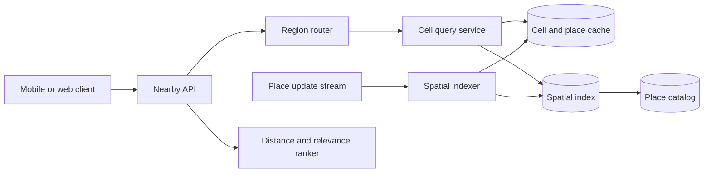

# 16. Proximity Service

**Difficulty:** Medium | **Key concepts:** geospatial indexing, cell expansion, ranking, freshness, regional sharding | **Related LeetCode:** [K Closest Points to Origin](../../neetcode_150/0973-k-closest-points-to-origin-medium/README.md)

## 1. Requirements

### Functional

- Find nearby places or entities around a coordinate and return the closest relevant results.
- Filter by category, open status, price, and user-selected radius.
- Support location updates, place edits, and deletion.
- Return distance or estimated travel time and paginate larger result sets.
- Support regional data ownership and category-specific ranking.
- Apply user privacy controls before exposing precise locations.

### Non-functional

- Serve 10 million daily active users with p99 search latency below 100 ms.
- Keep place updates visible within a minute in the same region.
- Avoid scanning all entities for each location query.
- Handle dense urban cells and sparse rural regions without one fixed cell size.
- Keep precise user coordinates only as long as needed for a request.

### Out of scope

- Turn-by-turn routing and map tile rendering.
- Determining business truth such as whether a venue is actually open.
- Continuous background tracking of a user's location.

## 2. Back-of-the-envelope estimates

### Assumptions

- 10 million daily active users perform 20 proximity searches each per day.
- The catalog contains 1 billion place records worldwide.
- A place record and common index fields average 200 bytes.
- Each search returns 20 items averaging 150 bytes of response metadata.
- Peak query load is ten times average.

### Request volume

- Searches per day: `10M × 20 = 200M`.
- Average proximity-search QPS: `200M / 86,400 ≈ 2,315`.
- Peak proximity-search QPS: about 23,150.
- At 20 results × 150 bytes, peak response bandwidth is about 69 MB/s.
- Updates at 1M/day average only about 12/s, but bursts may be higher.

### Index capacity

- Raw catalog storage: `1B × 200 bytes = 200 GB`.
- Spatial index, replicas, and secondary category indexes can multiply this several times.
- Plan 1–2 TB per full copy depending on geometry and retained metadata.
- Regional replicas and hot-cell caches need separate memory capacity.
- A cell storing 100,000 dense-city places may be served from a compact in-memory index.

### Five-year footprint, traffic, and cache check

- The modeled search-to-place-update ratio is `200M / 1M = 200:1`.
- Five-year catalog storage adds `1M × 1,825 × 200 bytes ≈ 365 GB` to the 200 GB initial catalog.
- Peak response bandwidth is about 69 MB/s for 20 results at 150 bytes each.
- Cache ten million hot place records at 200 bytes each in about 2 GB per region.
- The spatial index and replicas add roughly 1–2 TB per full regional copy.
- Keep precise user query coordinates out of the durable place cache and logs.

## 3. API design

### Search

- `GET /v1/nearby?lat=...&lon=...&radiusMeters=...&category=...&limit=20`
- Response includes place ID, approximate distance, display fields, and update version.
- Validate coordinate bounds and cap radius and result count.
- Use an opaque cursor for pagination with a stable center and ranking version.

### Update and entity management

- `PUT /v1/places/{placeId}` updates coordinates, category, and attributes.
- `DELETE /v1/places/{placeId}` creates a versioned tombstone.
- `POST /v1/places:batchUpdate` supports bounded ingestion from trusted sources.
- Require a source version to prevent delayed updates overwriting newer data.

### Privacy

- Use `POST /v1/nearby` when coordinates should not be stored in query logs.
- Round or bucket coordinates in telemetry.
- Never return another user's precise position through the general place API.

## 4. Data model

### Place and spatial index

| Field | Type | Purpose |
| --- | --- | --- |
| `place_id` | stable ID | Entity identity |
| `latitude, longitude` | fixed precision | Point location |
| `cell_id` | geospatial cell | Partition and candidate pruning |
| `category` | enum | Filter and ranking |
| `attributes` | compact map | Open state, price, and display metadata |
| `version` | integer | Update ordering and cache freshness |

- Use H3, S2, geohash, or an R-tree depending on query shape and implementation.
- Keep a cell-to-place index and a place-to-cell reverse mapping for moves.
- Store canonical place records in a durable database and index documents separately.
- Partition by region plus cell; include neighboring cells in boundary queries.
- Cache cell snapshots and invalidate by version after edits or deletions.

### Storage choice

- Use a durable catalog store for canonical place records and a specialized spatial index for candidate search.
- SQL is useful for place edits and constraints; a NoSQL spatial projection handles high-volume regional queries.

## 5. High-level architecture

- The API validates the request and selects the data region from its center point.
- The cell service enumerates cells covering the requested radius.
- Candidate retrieval uses cell and category indexes rather than a global scan.
- A ranker computes exact distance and optional business relevance for candidates.
- Updates fan out to the spatial index and versioned caches asynchronously.

## 6. Deep dives

### Cell coverage and candidate search

- Map the center and radius to a set of cells at an appropriate resolution.
- Query adjacent cells because a nearby point may cross a cell boundary.
- Use coarse cells for broad search and finer cells for dense locations.
- Expand outward until enough candidates exist or the requested radius is exhausted.
- Apply exact great-circle distance after candidate retrieval.
- Overfetch candidates to account for filters and ranking exclusions.

### Ranking and freshness

- Distance alone may not be the desired order; combine distance with quality and relevance.
- Make score components interpretable and avoid hiding hard filters in the ranker.
- Use a versioned ranking configuration for reproducible pagination.
- A place moving across cells needs remove-old/add-new operations with one version.
- Read-time tombstones prevent stale cache entries from returning deleted places.

### Regional boundaries

- Cities near a region edge may require a small neighboring-region query.
- Duplicate place IDs are merged before ranking.
- Define a home region for each cell and a bounded cross-region timeout.
- If the adjacent region is unavailable, return a partial-results indicator.
- Keep global place IDs stable even if ownership moves.

## 7. Scaling, bottlenecks & failure modes

- Shard spatial cells by region and density, not by equal geographic area alone.
- Dense cells are hot; split them by finer resolution or category.
- A large radius can touch too many cells; enforce a maximum and progressively expand.
- If the index lags, include index-version age in the response and monitoring.
- If a cache miss storm occurs, coalesce cell loads and throttle catalog fallback.
- Place-update duplicates are harmless when the version is monotonic and idempotent.
- Coordinate spoofing requires separate account and source validation.
- Keep query logs coarse or sampled to avoid sensitive location retention.
- If a cell owner fails, route to a replica and avoid waiting on all replicas.
- Monitor candidate count, cells queried, exact-distance CPU, and partial-result rate.

## 8. Trade-offs summary

| Decision | Chosen | Alternative | Why |
| --- | --- | --- | --- |
| Spatial index | Hierarchical cells | Full-table distance scan | Prunes candidates and supports regional ownership |
| Search | Cell expansion then exact distance | Fixed-radius one-cell lookup | Avoids cell-boundary misses |
| Updates | Versioned asynchronous indexing | Synchronous multi-index transaction | Keeps source updates fast |
| Ranking | Separate candidate and rank phases | Sort every global place | Bounds CPU to local candidates |
| Telemetry | Coarse coordinates | Raw coordinate logs | Reduces sensitive location retention |

## 9. Interview follow-ups

- **How do you find nearby results?** Cover the radius with cells, query candidates, then compute exact distances.
- **What if one cell is dense?** Use a finer cell level, category partition, or local split.
- **How do you prevent misses at a boundary?** Query intersecting neighbor cells and deduplicate by place ID.
- **Can the index be eventually consistent?** Yes within a stated update SLO, with version age and tombstones.
- **What if a query spans regions?** Use bounded parallel regional reads and return partial status on timeout.
- **How do you protect privacy?** Avoid persistent precise query logs and restrict user-location access.
- **How would ranking use travel time?** Send a small candidate set to a routing service under a strict budget.

## 10. Video & further reading

- [YouTube search: system design proximity service](https://www.youtube.com/results?search_query=system+design+proximity+service)
- [H3 geospatial indexing system](https://h3geo.org/)
