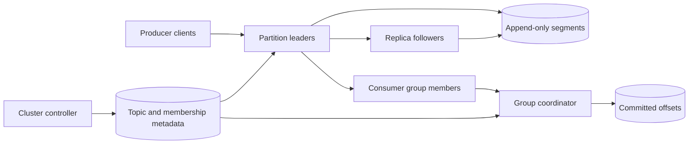

# 17. Message Queue (Kafka-Style)

**Difficulty:** Hard | **Key concepts:** append-only log, partitions, consumer groups, offsets, retention, replication | **Related LeetCode:** No directly related problem in the current repository.

## 1. Requirements

### Functional

- Producers publish keyed or unkeyed records to named topics.
- Consumers read records in partition order and resume from committed offsets.
- Support consumer groups where partitions are assigned among group members.
- Retain records by time or size and allow replay within the retention window.
- Replicate data and elect a leader after broker failure.
- Expose lag, throughput, storage, and partition health metrics.

### Non-functional

- Sustain 1 million records per second with average payload near 1 KB.
- Keep append acknowledgement below 50 ms at p99 for a replicated write.
- Preserve per-partition order and durability according to the configured quorum.
- Scale throughput by adding partitions and brokers.
- Isolate slow consumers so they do not block unrelated groups.

### Out of scope

- A general transaction coordinator across arbitrary external databases.
- Exactly-once side effects in consumer applications without transactional cooperation.
- Interactive queries over the full retained log.

## 2. Back-of-the-envelope estimates

### Assumptions

- Peak ingest is 1 million records/s; average payload is 1 KB.
- Replication factor is three.
- Retain raw data for seven days.
- 100 partitions per topic family are available for the initial workload.
- Sequential disk throughput is 500 MB/s per broker before replication overhead.
- Illustrative producers serve 10M DAU with 100 events/user/day; 1M records/s is the peak capacity target.

### Throughput and storage

- Average producer QPS from `10M DAU × 100 events/day` is `1B / 86,400 ≈ 11.6K`; peak capacity is 1M QPS.
- Ingress payload: `1M × 1 KB ≈ 1 GB/s`.
- Seven-day raw retention: `1 GB/s × 86,400 × 7 ≈ 605 TB`.
- Three replicas require roughly 1.8 PB before indexes and safety margin.
- At 70% disk utilization, provision around 2.6 PB of raw broker capacity.
- 100 partitions average 10,000 records/s and 10 MB/s each at peak.
- A partition count that is too low limits parallelism; too high increases metadata and rebalance cost.

### Network

- Replication traffic adds about 2 GB/s beyond producer ingress at RF=3.
- Consumer egress can exceed ingress when multiple independent groups read the log.
- Compression and batching reduce protocol overhead but add CPU and latency trade-offs.
- Reserve bandwidth for broker recovery and follower catch-up.

### Five-year footprint, traffic, and cache check

- Assume consumer reads are twice producer writes (`2:1`) across independent consumer groups.
- Five-year archive storage at 1 GB/s ingest is `1 GB/s × 86,400 × 1,825 ≈ 158 PB` raw.
- The broker's seven-day live tier is about 605 TB raw, or 1.8 PB at replication factor three.
- Peak producer ingress is 1 GB/s; replication adds about 2 GB/s and consumers add their own egress.
- A five-minute broker page cache at 1 GB/s needs about `1 GB/s × 300 s = 300 GB`.
- Archive cold segments outside the broker tier rather than retaining the full five-year log on hot disks.

## 3. API design

### Produce

- `POST /v1/topics/{topic}/records` accepts a bounded batch.
- Each record contains key, value, headers, timestamp, and optional idempotent producer sequence.
- Response returns partition and offset for every accepted record.
- Use key hashing to route related records to one partition.

### Consume

- `POST /v1/consumers/{group}/poll` returns records and next offsets.
- `POST /v1/consumers/{group}/commit` commits offsets for assigned partitions.
- Consumer members join, heartbeat, and leave a group through a coordinator API.
- A consumer may replay by supplying an earlier offset within retention.

### Administration

- `PUT /v1/topics/{topic}` configures partition count, replication, and retention.
- `GET /v1/groups/{group}/lag` returns per-partition committed versus latest offsets.
- Topic changes use a versioned control-plane record and an audit log.

## 4. Data model

### Topic partition log

| Field | Type | Purpose |
| --- | --- | --- |
| `topic_id` | stable ID | Namespace and retention policy |
| `partition_id` | integer | Ordered append stream |
| `offset` | 64-bit integer | Record position within partition |
| `leader_epoch` | integer | Fence stale leaders |
| `record_batch` | segment | Compressed records and checksums |
| `group_offset` | `(group, partition)` | Consumer restart position |

- Persist partition data as append-only segment files.
- Replicate partition leaders to followers in separate failure domains.
- Store topic and group metadata in a replicated consensus-backed control plane.
- Keep consumer offsets separate from record payloads for compact reads.
- Use checksummed batch indexes to locate offsets within large segments.

### Storage choice

- Append-only partition logs on broker disks fit sequential writes and ordered replay.
- SQL rows and indexes add random-write overhead; a consensus-backed store is reserved for compact cluster metadata.

## 5. High-level architecture

- Producers discover partition leaders and batch records to the owning broker.
- The leader appends records and waits for the configured replica acknowledgement.
- Followers fetch log segments and report their replication position.
- Group coordinators assign partitions and track membership generations.
- Consumers poll independently and commit offsets after their side effects are durable.

## 6. Deep dives

### Partitioning and ordering

- A partition is the unit of ordering, replication, and consumer parallelism.
- Hashing a stable key keeps related records in one ordered partition.
- A hot key can overload one partition even when the topic has many partitions.
- Increasing partition count may remap keys and complicate per-key ordering.
- Unkeyed records can spread load but provide no key-local ordering guarantee.
- Keep partition ownership stable enough to avoid continuous consumer rebalances.

### Replication and leader changes

- A leader appends locally and replicates to followers in the configured set.
- Acknowledgement policy balances durability against latency and availability.
- Leader epochs fence stale leaders after a controller-driven election.
- An in-sync replica set limits data loss but may reduce availability during a partition.
- Recovery replays the committed log and truncates uncommitted divergent tails.
- Replica catch-up competes with client traffic and must be rate-limited.

### Consumer groups and delivery semantics

- A group member owns a subset of partitions and processes each partition in order.
- Rebalance generations prevent an old member from committing after reassignment.
- At-least-once delivery is the default when consumers commit after side effects.
- Exactly-once processing needs idempotent effects or a transaction spanning output and offset.
- Commit too early and a crash loses work; commit too late and a crash duplicates work.
- Monitor lag age as well as record count to understand user-visible delay.

## 7. Scaling, bottlenecks & failure modes

- Add partitions and brokers to increase parallel append and consume throughput.
- Disk throughput, network, compression CPU, and hot keys can bottleneck independently.
- If a broker fails, elect an eligible replica and update metadata epochs.
- If replicas lag, reject unsafe writes or accept a documented weaker durability level.
- A slow consumer does not block the log but can exhaust retention before it catches up.
- Apply quotas by producer and consumer group to prevent noisy-neighbor overload.
- Large records should be rejected or stored externally with a reference in the queue.
- Rebalances should be cooperative and bounded to reduce stop-the-world pauses.
- Retention deletion must not remove data still within an advertised replay period.
- Monitor under-replicated partitions, ISR churn, disk headroom, and group lag.

## 8. Trade-offs summary

| Decision | Chosen | Alternative | Why |
| --- | --- | --- | --- |
| Storage | Append-only partition log | Per-message relational rows | Efficient sequential write and replay |
| Order | Per-partition | Global topic order | Scales while preserving useful local order |
| Delivery | At-least-once baseline | Claimed universal exactly-once | Makes duplicate handling explicit |
| Acknowledgement | Replicated quorum | Leader-only ack | Protects accepted records from one broker loss |
| Consumer state | Explicit offsets | Destructive queue pop | Supports replay and independent groups |

## 9. Interview follow-ups

- **How is ordering preserved?** A partition leader assigns offsets and consumers process one partition sequentially.
- **Can one topic have unlimited consumers?** Parallelism is bounded by partition count within one group.
- **How do you handle poison messages?** Use bounded retry, a dead-letter topic, and offset-aware recovery.
- **What does exactly once mean?** It requires atomicity between input offset and output effect, not just broker dedupe.
- **What if a consumer is slow?** Lag grows independently; scale members up to partition count or optimize processing.
- **How do you avoid hot partitions?** Reconsider key selection or split hot-key semantics at the application layer.
- **What happens during leader election?** A new in-sync leader is selected and fenced by a higher epoch.

## 10. Video & further reading

- [YouTube search: system design message queue Kafka](https://www.youtube.com/results?search_query=system+design+message+queue+Kafka)
- [Kafka design documentation](https://kafka.apache.org/documentation/#design)
