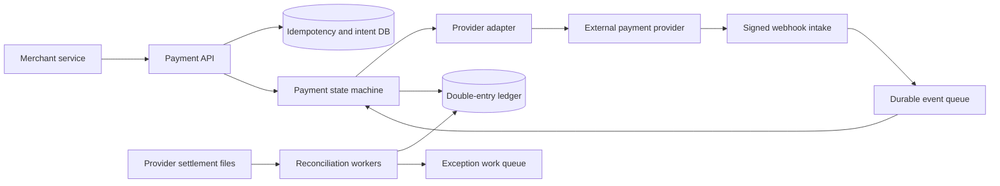

# 18. Payment System

**Difficulty:** Hard | **Key concepts:** idempotency, payment state machine, double-entry ledger, provider adapters, reconciliation, risk controls | **Related LeetCode:** [Design an ATM Machine](../../design/2241-design-an-atm-machine-medium/README.md), [Order Management System](../../design/3822-design-order-management-system-medium/README.md)

## 1. Requirements

### Functional

- Create a payment intent for a customer and merchant order.
- Authorize, capture, void, refund, and report payment status.
- Integrate multiple external payment providers behind a normalized interface.
- Prevent duplicate charges when clients or providers retry requests.
- Maintain an auditable ledger and reconcile internal state with provider settlement.
- Handle asynchronous webhooks and delayed provider responses.

### Non-functional

- Sustain 10 million payment intents per day with strong durability.
- Acknowledge an internal intent within 150 ms at p99, excluding provider latency.
- Never report a successful capture before the provider confirms it.
- Preserve monetary correctness across retries, partial failures, and failover.
- Minimize sensitive card data exposure and comply with applicable payment controls.

### Out of scope

- Card network internals, merchant acquiring contracts, and full fraud model design.
- Storing raw card numbers in the application database.
- Instant finality for all bank transfer rails.

## 2. Back-of-the-envelope estimates

### Assumptions

- 10 million payment intents/day, with one authorization and one capture each.
- Average payment request and state metadata total 2 KB.
- 10% of payments are refunded; each refund creates a separate audited event.
- Peak traffic is twelve times average.
- Retain ledger history for seven years.

### Request volume

- Average payment-intent QPS: `10M / 86,400 ≈ 116`.
- Two provider actions per payment give about 232 external-action QPS on average.
- Peak payment-event QPS is roughly 1,400 before retries and webhooks.
- A provider timeout can cause retry bursts; use backoff and per-provider budgets.
- Reconciliation batch traffic is scheduled separately from online authorization.

### Storage and correctness

- Seven-year intents: `10M × 365 × 7 = 25.55B`.
- At 2 KB each, raw state is about 51 TB, before indexes and replication.
- Double-entry ledger requires at least two postings per monetary transfer.
- Keep append-only ledger rows and compact read models separately.
- Payment tokens and metadata are small; never budget for raw card-number storage.
- External settlement files may add large but time-bounded reconciliation inputs.
- At 2 KB per intent, average and peak metadata bandwidth are about `116 × 2 KB ≈ 232 KB/s` and `1,400 × 2 KB ≈ 2.8 MB/s`.

### Five-year footprint, traffic, and cache check

- Assume payment-status reads outnumber intent writes by `10:1`; provider attempts remain separately metered.
- Five-year intent storage at 10M/day and 2 KB each is `10M × 1,825 × 2 KB ≈ 36.5 TB` raw.
- A seven-year ledger retains about 51 TB of intent-equivalent metadata before postings and replicas.
- The online provider path averages about 232 external actions/s before retries; batch reconciliation is separate.
- Cache one million recent idempotency records at 256 bytes each in about 256 MB.
- Keep provider configuration and token metadata in encrypted, access-controlled caches.

## 3. API design

### Payment intent

- `POST /v1/payment-intents` includes merchant order ID, amount, currency, and method token.
- Require an idempotency key scoped to merchant and operation.
- Response returns intent ID, current state, and whether customer action is needed.
- `POST /v1/payment-intents/{id}/confirm` begins an authorization attempt.

### Capture and refund

- `POST /v1/payment-intents/{id}/capture` supports amount and idempotency key.
- `POST /v1/payments/{id}/refunds` supports full or bounded partial refunds.
- `POST /v1/payment-intents/{id}/cancel` voids an uncaptured authorization when possible.
- Return a stable operation ID even when the provider result is pending.

### Provider callbacks

- `POST /v1/webhooks/{provider}` verifies signature and provider event ID.
- Acknowledge only after the event is durably recorded.
- Callback processing is idempotent and may arrive out of order.
- Do not treat a client redirect as proof of provider settlement.

## 4. Data model

### Intent, attempt, and ledger

| Entity | Key | Contents |
| --- | --- | --- |
| Payment intent | `intent_id` | Merchant, order, amount, currency, state |
| Provider attempt | `attempt_id` | Provider, idempotency key, request/response status |
| Ledger transaction | `transaction_id` | Business event and immutable effective time |
| Ledger posting | `(transaction_id, account_id)` | Signed amount and currency |
| Idempotency record | `(merchant_id, key)` | Request hash, result, expiry |

- Store intent transitions and idempotency records transactionally in SQL.
- Ledger postings are append-only and balanced per currency.
- Provider tokens and webhook secrets live in a managed secret store.
- Store card references as provider tokens; never store sensitive authentication data.
- Partition older ledger rows by accounting period while preserving query auditability.

### Storage choice

- Use a relational database for payment intents, idempotency, and ACID ledger postings.
- NoSQL can hold asynchronous provider telemetry, but cannot replace the balanced accounting transaction.

## 5. High-level architecture

- API validates merchant authorization and records the intent before external calls.
- Orchestrator transitions state and calls a provider adapter with a stable key.
- Webhooks are verified and queued before asynchronous state application.
- Ledger writes occur in a transaction with the corresponding internal business event.
- Reconciliation compares settlement reports and creates actionable exceptions.

## 6. Deep dives

### Idempotency and state transitions

- Persist `(merchant, idempotency_key, request_hash)` before beginning provider work.
- A repeated key with the same request returns the same result.
- A repeated key with a different amount or currency returns a conflict.
- Model authorized, capture-pending, captured, voided, refund-pending, and failed states explicitly.
- Use conditional transitions so a delayed webhook cannot move a terminal state backward.
- An ambiguous timeout is pending, not automatically failed; query provider status before retry.

### Ledger and monetary correctness

- Record balanced debit and credit postings for each capture, refund, and fee.
- Use integer minor units or exact decimals; never binary floating-point currency.
- Ledger rows are immutable; corrections use compensating entries.
- The sum of postings per transaction and currency must equal zero.
- Rebuild account balances as a projection and periodically compare to ledger totals.
- Keep payment state and accounting postings linked by stable transaction IDs.

### External providers and reconciliation

- Normalize provider capabilities but preserve provider-specific status for audit.
- Provider adapters own authentication, timeout, idempotency, and retry policy.
- Verify webhook signatures and deduplicate provider event IDs.
- Settlement files are the final source for matching external money movement.
- Reconcile by provider reference, amount, currency, and settlement date.
- Route unmatched records to a human-review queue; never silently balance them away.

## 7. Scaling, bottlenecks & failure modes

- Partition API traffic by merchant and use bounded per-provider connection pools.
- A provider outage should queue eligible work without holding application threads.
- Circuit breakers prevent a failing provider from exhausting the orchestrator.
- A duplicate callback is safe because event application is idempotent.
- A database failover must preserve idempotency records before retrying external actions.
- Ledger writes need durable backups, audit trails, and tested restore procedures.
- Never replay a provider charge blindly after an ambiguous network timeout.
- Rate-limit by merchant and instrument; monitor declines separately from infrastructure errors.
- Protect webhook endpoints against replay and forged signatures.
- Reconciliation lag and unmatched settlement amount need financial severity alerts.

## 8. Trade-offs summary

| Decision | Chosen | Alternative | Why |
| --- | --- | --- | --- |
| State | Explicit intent state machine | One mutable status | Makes asynchronous transitions auditable |
| Ledger | Append-only double-entry | Update one balance field | Supports reconciliation and compensating corrections |
| Provider calls | Adapter plus idempotency | Direct calls from product services | Centralizes retries, secrets, and failure policy |
| Webhooks | Durable queue before processing | Synchronous state mutation | Handles duplicates, bursts, and downtime |
| Amounts | Integer minor units | Floating-point numbers | Prevents rounding errors |

## 9. Interview follow-ups

- **What if the provider times out after charging?** Mark the attempt ambiguous, query provider state, and reuse the idempotency key.
- **How do you prevent duplicate captures?** Enforce a unique operation key and conditional intent transition.
- **Can a successful payment be reversed?** Add a compensating refund or adjustment; never erase ledger history.
- **How do you know internal balances are correct?** Reconcile ledger projections against independent provider settlement files.
- **What if a webhook arrives before the API response?** Both paths update the same idempotent state machine.
- **How do partial captures work?** Track captured amount and enforce remaining authorized amount atomically.
- **How do you reduce PCI scope?** Use hosted fields or tokenization and keep raw card data out of application systems.

## 10. Video & further reading

- [YouTube search: system design payment system](https://www.youtube.com/results?search_query=system+design+payment+system)
- [Stripe API idempotent requests](https://docs.stripe.com/api/idempotent_requests)
