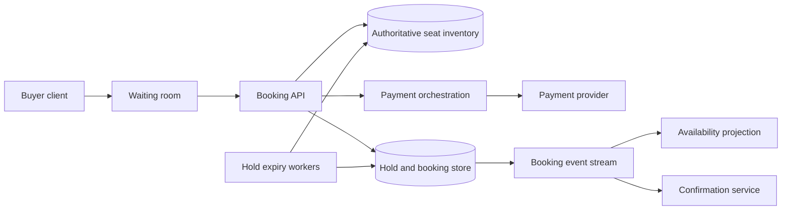

# 19. Ticket Booking and Seat Holds

**Difficulty:** Medium | **Key concepts:** inventory, expiring holds, contention, idempotency, payment confirmation | **Related LeetCode:** [Booking Concert Tickets in Groups](../../design/2286-booking-concert-tickets-in-groups-hard/README.md)

## 1. Requirements

### Functional

- Let users browse events, venues, performances, and seat availability.
- Temporarily hold selected seats while the customer checks out.
- Confirm a booking after payment or release seats after timeout.
- Support general-admission inventory as well as assigned seats.
- Prevent two confirmed bookings from owning the same seat.
- Send booking confirmation and provide cancellation or refund status.

### Non-functional

- Handle large on-sale bursts without overselling inventory.
- Return browse results within 200 ms at p99 outside extreme queueing.
- Keep hold confirmation correct despite retries, worker failure, and payment delay.
- Make availability eventually fresh while reservation decisions remain authoritative.
- Prevent one automated buyer from monopolizing a sale.

### Out of scope

- Event discovery ranking, venue operations, and ticket resale marketplace.
- Payment network internals beyond idempotent authorization and capture.
- Guaranteeing a user keeps a hold if checkout exceeds its stated expiry.

## 2. Back-of-the-envelope estimates

### Assumptions

- 5 million booking searches/day and 1 million hold attempts/day.
- A popular on-sale event has 100,000 seats and a 50× traffic burst.
- A hold lasts 8 minutes and contains 1–6 seats.
- A booking and audit record average 2 KB.
- Confirmed booking history is retained for seven years.

### Request volume

- Average hold QPS: `1M / 86,400 ≈ 12`.
- A 50× on-sale burst is about 580 hold attempts/s for one event.
- Browse QPS is about `5M / 86,400 ≈ 58/s` average, with a separate burst peak.
- At 580 holds/s and 8 minutes, up to `580 × 480 ≈ 278,000` holds could be live fleet-wide during a prolonged burst.
- A single event's inventory shard is the contention hotspot, not the total system.

### Storage and timer volume

- Seven years of 1M bookings/day is `2.555B` bookings.
- At 2 KB each, raw booking history is about 5.1 TB before indexes and replicas.
- Hold state is small but expires quickly; an 8-minute TTL limits steady state.
- Store expiry metadata in a delay queue or indexed expiry column, not one sleeping worker per hold.
- Availability cache is derived and can be rebuilt from authoritative seat state.

### Five-year footprint, traffic, and cache check

- The modeled browse-to-hold ratio is `5M / 1M = 5:1`.
- Five-year booking records at 1M/day and 2 KB each require `1M × 1,825 × 2 KB ≈ 3.65 TB` raw.
- Three copies require about 11 TB before indexes and event audit history.
- On-sale write bandwidth at 580 holds/s and six seats per hold is roughly 7 MB/s at 2 KB per state update.
- Cache 1,000 popular event maps at `100K seats × 128 bytes` in about 12.8 GB.
- Holds themselves expire after eight minutes and are not retained as a five-year cache.

## 3. API design

### Browse and hold

- `GET /v1/events/{eventId}/availability?section=...` returns a versioned seat map or counts.
- `POST /v1/holds` includes event ID, seat IDs or quantity, and an idempotency key.
- Response includes hold ID, expiry time, exact seats, and checkout deadline.
- `DELETE /v1/holds/{holdId}` releases an active hold.
- A repeated hold request with the same key returns its original result.

### Confirm and cancel

- `POST /v1/holds/{holdId}/confirm` includes payment authorization reference.
- Confirmation succeeds only if the hold remains active and unexpired.
- `POST /v1/bookings/{bookingId}/cancel` requests policy-checked cancellation.
- Payment capture and booking confirmation use a saga with explicit pending states.

### Queue and fairness

- `POST /v1/sales/{eventId}/queue-token` obtains a signed place in a virtual waiting room.
- The token is scoped to one sale and expires after a bounded time.
- Enforce per-account and per-device purchase limits at hold and confirmation.

## 4. Data model

### Inventory and booking

| Entity | Key | Contents |
| --- | --- | --- |
| Seat inventory | `(event_id, seat_id)` | Available, held, or sold state and version |
| Hold | `hold_id` | Buyer, seat set, expiry, idempotency key, state |
| Booking | `booking_id` | Buyer, event, seats, payment reference, status |
| Hold member | `(hold_id, seat_id)` | Seats assigned to one hold |
| Sale policy | `event_id` | Queue, limits, sale windows, hold duration |

- A relational transaction and unique constraint protect assigned-seat ownership.
- General admission uses an atomic remaining-capacity counter or inventory buckets.
- Record immutable seat-state transitions for audit and recovery.
- Use database time for expiry comparisons to avoid client-clock differences.
- Partition seat inventory by `event_id` so one event's allocation stays within one contention boundary.
- Cache availability as a versioned projection; never treat a cache hit as a hold.

### Storage choice

- SQL transactions and unique constraints are the simplest authority for seat holds and booking confirmation.
- NoSQL projections can serve browse availability, but must never authorize a sale from a stale cache.

## 5. High-level architecture

- The waiting room controls admission before the inventory database is saturated.
- The booking API performs an atomic conditional transition from available to held.
- Hold expiry workers release seats only if the hold is still active and expired.
- Payment orchestration confirms or compensates using idempotent operations.
- Availability projections update asynchronously for browsing.

## 6. Deep dives

### Atomic holds and inventory

- A hold transaction locks or conditionally updates all requested seats together.
- If any requested seat is unavailable, roll back the full group request.
- Use a unique active owner constraint to make double sale impossible.
- For general admission, decrement capacity with a conditional `remaining >= quantity`.
- Keep the transaction short; do not call a payment provider while holding seat locks.
- Return a stable hold ID so clients can retry after an ambiguous network response.

### Expiration and payment saga

- Store `expires_at` and compare against database time during confirmation.
- Expiry worker changes state only when `state=held` and deadline has passed.
- Confirmation wins or expiry wins through a conditional state transition, never both.
- Authorize payment before final commit when practical; capture after seat confirmation.
- If payment capture fails, release seats or move to a clearly visible recovery state.
- If provider result is ambiguous, reconcile it before retrying capture.

### On-sale overload and fairness

- A virtual queue smooths a burst before requests reach the hot event partition.
- Issue short-lived signed tokens and admit a controlled number of buyers per second.
- Randomize within a queue window when strict arrival ordering is not operationally safe.
- Apply bot detection, per-account limits, and rate controls without blocking accessibility.
- Use event-specific shards or dedicated capacity for unusually popular sales.

## 7. Scaling, bottlenecks & failure modes

- Partition authoritative inventory by event and use a dedicated shard for hot events.
- A single event may still require serialization; admission control is often cheaper than lock contention.
- If the cache is stale, the authoritative conditional update rejects an unavailable seat.
- If expiry processing lags, confirmation checks time synchronously and prevents late purchase.
- A payment outage leaves holds pending only for a bounded checkout window.
- If the database fails after payment authorization, void the authorization during recovery.
- Duplicate client requests return the same hold or booking through idempotency records.
- Queue tokens are single-sale scoped and cannot be replayed for a different event.
- Reconciliation detects seats marked sold without a corresponding booking.
- Monitor hold success, expiry lag, oversell count (must remain zero), queue wait, and payment ambiguity.

## 8. Trade-offs summary

| Decision | Chosen | Alternative | Why |
| --- | --- | --- | --- |
| Hold authority | Conditional transactional inventory update | Availability cache lock | Prevents overselling with a single source of truth |
| Browse | Asynchronous availability projection | Query seat rows for every map view | Keeps read-heavy browse traffic off the write path |
| Expiry | Conditional TTL worker plus request-time check | Trust scheduled deletion only | Protects correctness when workers lag |
| Burst control | Virtual waiting room | Let database absorb all traffic | Smooths contention for one hot event |
| Payment | Saga with idempotent provider actions | Cross-system transaction | External provider cannot join a database transaction |

## 9. Interview follow-ups

- **How do you guarantee no double booking?** Use a unique seat owner and conditional state transition in the authoritative store.
- **What if a hold expires during payment?** Confirm and expiry race on one conditional transition; only one wins.
- **Can a user hold multiple seats?** Reserve the group atomically or fail without a partial hold.
- **How do you handle general admission?** Atomically decrement a bounded capacity counter.
- **What if payment times out?** Mark ambiguous, query provider, and do not release or capture blindly.
- **How do you survive a flash sale?** Admit buyers through a controlled queue and isolate the event shard.
- **Why is availability allowed to be stale?** It is advisory; the hold transaction is authoritative.

## 10. Video & further reading

- [YouTube search: system design ticket booking](https://www.youtube.com/results?search_query=system+design+ticket+booking)
- [PostgreSQL transaction isolation documentation](https://www.postgresql.org/docs/current/transaction-iso.html)
