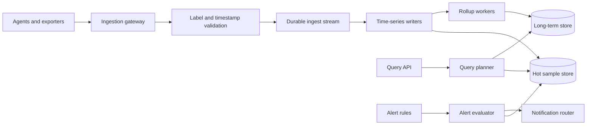

# 20. Metrics Monitoring

**Difficulty:** Medium | **Key concepts:** time-series ingestion, labels, rollups, cardinality, alert evaluation | **Related LeetCode:** No directly related problem in the current repository.

## 1. Requirements

### Functional

- Ingest numeric samples from hosts, services, and infrastructure agents.
- Query time ranges with filters, aggregation, grouping, and downsampling.
- Define alert rules with thresholds, windows, and notification routes.
- Preserve service-level labels while preventing unbounded label cardinality.
- Support dashboard reads and incident-time high-resolution queries.
- Retain raw samples briefly and longer-term rollups for trend analysis.

### Non-functional

- Ingest one million samples per second at peak.
- Make recent data queryable within 30 seconds at p95.
- Keep alert evaluation delay below one minute for standard rules.
- Survive agent and storage node failure without silently dropping all data.
- Bound cost through sampling, aggregation, compression, and retention tiers.

### Out of scope

- Distributed tracing and log search implementation.
- A complete incident-management product.
- Arbitrary joins across metrics, logs, and business databases.

## 2. Back-of-the-envelope estimates

### Assumptions

- One million monitored entities emit ten metrics every ten seconds.
- Each sample stores timestamp, value, series ID, and compact flags in 16 bytes.
- Peak ingestion is twice the average because of synchronized scrapes.
- Keep raw resolution for seven days and one-minute rollups for one year.
- Replication factor is three before compression.

### Ingestion and storage

- Average metric-ingest QPS: `1M entities × 10 metrics / 10 seconds = 1M samples/s`.
- Daily samples: `1M × 86,400 = 86.4B`.
- Raw daily bytes: `86.4B × 16 bytes ≈ 1.38 TB`.
- Seven-day raw retention: about 9.7 TB before replication.
- Three copies require 29 TB raw; compression and delta encoding reduce this.
- Peak metric-ingest QPS is 2M samples/s, or about 32 MB/s of compact payload.

### Query and index cost

- Ten metrics per entity yields about 10 million active series before label variants.
- A 10× cardinality mistake increases index memory and storage by the same order.
- A dashboard querying 100 series over one hour at 10-second resolution reads 36,000 samples.
- One-minute rollups reduce one-year scans by a factor of six versus 10-second samples.
- Keep query concurrency bounded so one broad dashboard cannot starve alert evaluation.

### Five-year footprint, traffic, and cache check

- Assume dashboard queries are far fewer than writes, roughly one query per 864 samples (`100M / 86.4B` daily).
- Five years of raw samples is `1.38 TB/day × 1,825 ≈ 2.52 PB`, before three-way replication.
- Keep only seven days at raw resolution and retain long-range rollups in the cold tier.
- Peak sample payload bandwidth is about 32 MB/s at two million samples/s.
- One hour of ten-second samples for 10M active series at 16 bytes is about 57.6 GB.
- Provision a 64 GB query cache for recent hot series and popular dashboard windows.

## 3. API design

### Write samples

- `POST /v1/metrics:write` accepts a bounded batch of series and timestamped values.
- Each series contains metric name, allowlisted labels, and typed samples.
- Agents may retry a batch; duplicate timestamps are resolved by a documented policy.
- Reject timestamps too far in the future or outside the ingestion window.

### Query

- `POST /v1/metrics:query` includes expression, time range, step, and maximum points.
- Response returns series labels, aligned timestamps, values, and partial-data status.
- Enforce query timeout and per-tenant sample budgets.
- Return the effective resolution when downsampling is applied.

### Alert configuration

- `PUT /v1/alerts/{ruleId}` stores expression, window, threshold, and notification target.
- `GET /v1/alerts/{ruleId}/state` reports pending, firing, or resolved with timestamps.
- Rule versions are immutable for audit and rollback.
- Alert evaluation service owns state transitions; clients cannot mark an alert resolved.

## 4. Data model

### Series and sample blocks

| Field | Type | Purpose |
| --- | --- | --- |
| `series_id` | stable hash | Maps normalized labels to a time-series partition |
| `metric_name` | bounded string | Measurement identity |
| `labels` | allowlisted map | Dimensions for filtering and grouping |
| `timestamp` | integer time | Sample ordering and retention |
| `value` | numeric | Gauge, counter, or histogram component |
| `resolution` | interval | Raw or downsampled block |

- Index series by metric name and selected label dimensions.
- Store samples in time-ordered compressed blocks.
- Keep a series catalog with cardinality quotas and last-seen time.
- Roll up counter rates, histogram buckets, and gauge aggregates according to type.
- Alert state records include rule version, evaluation timestamp, and notification status.

### Storage choice

- A columnar time-series engine is better for append-heavy samples and time-range scans than a normalized SQL table.
- SQL remains useful for alert rules and tenant configuration, which are small and transaction-oriented.

## 5. High-level architecture

- Agents batch samples and send them to regional ingestion gateways.
- Gateways authenticate tenants, validate labels, and apply per-tenant limits.
- A durable stream absorbs bursts and decouples producers from storage writers.
- Query planner selects hot or rolled-up data and bounds fan-out.
- Alert evaluation reads a protected capacity pool and emits state changes downstream.

## 6. Deep dives

### Time-series layout and resolution

- Partition by time bucket and series hash to distribute writes and bound scans.
- Compress timestamps with delta encoding and values with type-aware codecs.
- Raw data supports incident debugging; rollups support long-range trends.
- Counter rollups need reset handling and rate calculation, not a plain average.
- Histogram rollups must preserve bucket counts or quantile meaning is lost.
- Retention deletion removes whole time blocks where possible.

### Cardinality and labels

- A label such as request ID or user ID can create one series per event.
- Allowlist labels, cap distinct values, and reject or drop offending dimensions.
- Normalize ephemeral pod names when a stable service-level dimension is sufficient.
- Keep raw high-cardinality identifiers in traces or logs, not metric labels.
- Monitor series creation rate and top contributors by tenant.
- Cardinality protection must be visible to users; silent truncation hides broken telemetry.

### Alert evaluation

- Evaluate rules on a fixed cadence with a bounded time window.
- Use pending duration and hysteresis to avoid alert flapping.
- Deduplicate notifications by alert key and route changes rather than every sample.
- Missing data is distinct from zero; configure no-data behavior explicitly.
- Keep alert computation isolated from ad hoc dashboard queries.
- Record the exact rule version and input window for post-incident explanation.

## 7. Scaling, bottlenecks & failure modes

- Add ingestion partitions and writers as series volume and write rate grow.
- Hot metric names or tenants need sharding by series hash and quotas.
- If the stream backs up, reject low-priority telemetry before exhausting memory.
- If a writer fails, replay durable batches with duplicate-safe timestamp handling.
- A cardinality spike can exhaust catalog memory; enforce quotas at ingestion.
- Query fan-out can overload storage; cap time ranges, points, and concurrent scans.
- If rollups lag, serve raw data at a lower resolution or indicate stale data.
- Alert evaluator lag needs an explicit incident, not silent delayed alerts.
- Clock skew can misorder samples; validate timestamp bounds and expose correction.
- Protect critical system-health metrics from tenant traffic exhaustion.

## 8. Trade-offs summary

| Decision | Chosen | Alternative | Why |
| --- | --- | --- | --- |
| Storage | Compressed time-series blocks | One row per sample in generic SQL | Efficient append and range scans |
| Ingestion | Durable stream buffer | Direct synchronous write to all stores | Absorbs bursts and enables replay |
| Retention | Raw plus rollups | Keep all samples forever | Controls cost while preserving trends |
| Labels | Allowlist and quotas | Arbitrary labels | Prevents uncontrolled cardinality |
| Alerts | Dedicated evaluator capacity | Share all query workers | Keeps alerts timely during dashboard load |

## 9. Interview follow-ups

- **Why are metrics labels dangerous?** Unbounded values create a distinct series and index entry per value.
- **How do counters roll up?** Detect resets and aggregate monotonic deltas, not raw values alone.
- **What if ingestion is delayed?** Buffer durably, replay, and report data freshness to queries.
- **How do alerts avoid flapping?** Pending duration, hysteresis, and deduplicated state transitions.
- **Why not retain every raw sample?** Storage grows linearly with duration and high-resolution volume.
- **How do you serve a year-long chart?** Use downsampled rollups at a step aligned to the requested range.
- **What if an alert query is expensive?** Limit expression cost and allocate isolated evaluation resources.

## 10. Video & further reading

- [YouTube search: system design metrics monitoring](https://www.youtube.com/results?search_query=system+design+metrics+monitoring)
- [Prometheus storage documentation](https://prometheus.io/docs/prometheus/latest/storage/)
