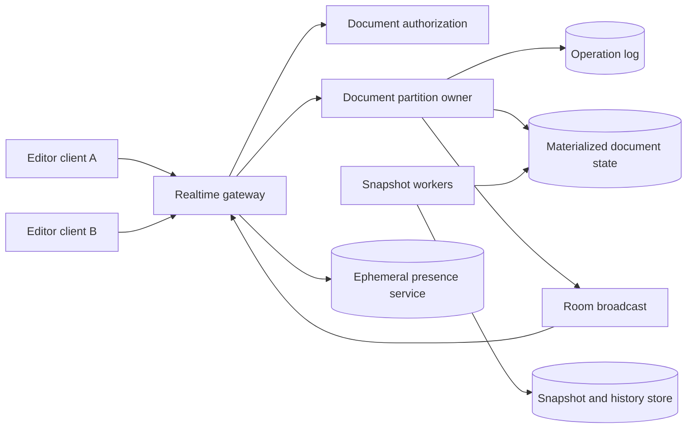

# 21. Collaborative Editor

**Difficulty:** Hard | **Key concepts:** operational transformation, CRDTs, operation log, snapshots, presence, conflict recovery | **Related LeetCode:** [Design a Text Editor](../../design/2296-design-a-text-editor-hard/README.md)

## 1. Requirements

### Functional

- Let multiple authorized users edit one document concurrently.
- Propagate insert, delete, and formatting operations to connected collaborators.
- Preserve a coherent document despite different network delays and operation order.
- Support offline edits, reconnect, conflict recovery, and document history.
- Show collaborator cursors and presence as best-effort ephemeral state.
- Enforce document permissions and revoke access without waiting for reconnect.

### Non-functional

- Support 1 million active editors at peak and 1 million operations per second.
- Deliver remote edits within 100 ms at p95 for collaborators in one region.
- Preserve acknowledged operations durably before confirming them to the sender.
- Bound per-document log size with snapshots and compaction.
- Keep document state correct through client retries and server failover.

### Out of scope

- Rich media editing, comments, and complete office-suite features.
- Guaranteeing identical cursor pixel positions across different renderers.
- Supporting arbitrary untrusted executable macros.

## 2. Back-of-the-envelope estimates

### Assumptions

- Peak active editors: 1 million.
- Each editor generates 0.2 semantic operations per second on average.
- Peak burst is five times the average.
- An encoded operation averages 100 bytes before transport framing.
- One million active documents average 100 KB of materialized text.

### Operation volume

- Average edit-operation QPS: `1M × 0.2 = 200,000`.
- Peak edit-operation QPS: `200,000 × 5 = 1,000,000`.
- Peak ingress bandwidth: `1M × 100 bytes = 100 MB/s`.
- Broadcasting one operation to four peers adds about 400 MB/s of egress bandwidth.
- Batching and compression reduce framing overhead but add a small delay.

### State and retention

- Active materialized documents: `1M × 100 KB ≈ 100 GB`.
- At 200K operations/s and 100 bytes, one day of raw log is about 1.73 TB.
- Thirty-day raw log retention is about 52 TB before replicas and indexes.
- Snapshots can bound replay, while archival history moves to cheaper storage.
- Cursor and presence state is ephemeral and should not be included in durable document size.

### Five-year footprint, traffic, and cache check

- Assume client sync reads and edit writes are approximately `1:1` outside fan-out broadcasts.
- Five-year average edit log is `200K operations/s × 100 bytes × 86,400 × 1,825 ≈ 3.15 PB` raw.
- Three replicated copies would require about 9.5 PB before snapshots and compaction.
- Peak edit ingress is 100 MB/s; four remote collaborators can add about 400 MB/s egress.
- Cache one million active 100 KB document states in about 100 GB.
- A five-minute operation buffer at average 20 MB/s adds about 6 GB per fleet copy.

## 3. API design

### Connect and synchronize

- `POST /v1/documents/{id}/sessions` authenticates user, device, and permission.
- `GET /v1/documents/{id}/sync?since=...` returns snapshot or operations after a version.
- WebSocket frames carry document ID, client ID, operation ID, and causal version.
- Server response confirms accepted version and broadcasts normalized operations.

### Edit and history

- `POST /v1/documents/{id}/operations` submits one or a bounded batch of edits.
- Each edit has a client-generated idempotency ID and base document version.
- `GET /v1/documents/{id}/history?cursor=...` returns snapshots and operation ranges.
- `POST /v1/documents/{id}/restore` creates a new version rather than deleting history.

### Presence

- `POST /v1/documents/{id}/presence` updates cursor and selection with a short lease.
- Presence updates are lossy and rate-limited; document edits are durable.
- Permission revocation invalidates session tokens and future operation acceptance.

## 4. Data model

### Document and operations

| Entity | Key | Contents |
| --- | --- | --- |
| Document | `document_id` | Owner, permission version, current snapshot version |
| Operation | `(document_id, sequence)` | Client ID, operation ID, transform/CRDT payload |
| Snapshot | `(document_id, version)` | Materialized state and checksum |
| Membership | `(document_id, user_id)` | Role, permission version, status |
| Session | `(document_id, client_id)` | Last acknowledged version and lease |

- Persist an append-only operation log partitioned by document ID.
- Use stable operation IDs to deduplicate client retries.
- Snapshots store materialized text and CRDT metadata needed for future merges.
- A single document has one ordered append authority or a CRDT merge strategy.
- Keep presence in an expiring in-memory store separate from durable edits.

### Storage choice

- A partitioned operation log fits per-document ordered append and replay at high write volume.
- SQL stores membership and ACL changes transactionally; the log is not modeled as relational row updates.

## 5. High-level architecture

- Clients send semantic operations rather than whole-document replacement.
- Gateway validates access and routes all document mutations to one owner partition.
- The document owner orders or merges operations and appends accepted changes.
- Accepted operations update materialized state and broadcast to connected clients.
- Snapshot workers periodically checkpoint state and advance the replay boundary.

## 6. Deep dives

### Operational transformation versus CRDT

- OT transforms a concurrent operation against operations already accepted by a server.
- A server-ordered OT design is easier to reason about but depends on a document sequencer.
- CRDTs merge operations through stable element identities and causal metadata.
- CRDTs support offline multi-writer progress but can carry more metadata and complex tombstones.
- Choose one model deliberately; mixing transform rules without shared invariants causes divergence.
- Test concurrent inserts at the same position, overlapping deletes, and undo behavior.

### Persistence, snapshots, and recovery

- Acknowledge an edit only after the durability level required by the product is reached.
- Snapshot every bounded number of operations or bytes, not only on user save.
- Include a checksum and schema version in each snapshot.
- Recovery loads the newest valid snapshot and replays later log entries.
- Compaction retains enough causal metadata for offline clients within the supported window.
- Clients beyond the retention window rebase from a fresh snapshot or create a conflict copy.

### Presence and authorization

- Presence leases expire quickly after a device disconnects.
- Throttle cursor movement independently from text mutations.
- Cursors are hints; they must not be used as edit locks.
- Check permission version on each mutation or short-lived session refresh.
- Revocation stops writes immediately and disconnects active sessions asynchronously.
- Avoid exposing a collaborator's email or identity to users without permission.

## 7. Scaling, bottlenecks & failure modes

- Partition documents by ID and isolate exceptionally large or active documents.
- A hot document is inherently serialized under a single-owner OT model.
- CRDT partitioning can spread work but requires careful causal metadata and merge testing.
- If a gateway fails, clients reconnect from their last acknowledged version.
- If the document owner fails, a fenced successor loads snapshot and replays the durable log.
- Slow clients receive a bounded queue and are disconnected to resynchronize if they fall too far behind.
- Snapshot lag increases recovery time; monitor operations since last durable checkpoint.
- Large paste operations need size limits and chunking to avoid blocking other edits.
- Compaction must not remove operations still needed by active offline clients.
- Validate edit rates and document size to prevent denial of service.

## 8. Trade-offs summary

| Decision | Chosen | Alternative | Why |
| --- | --- | --- | --- |
| Edit representation | Semantic operations | Whole-document sync | Reduces bandwidth and supports concurrent merge |
| Consistency model | OT with per-document sequencer | CRDT | Simpler centralized order for an online-first product |
| Persistence | Append log plus snapshots | Rewrite full document each edit | Efficient recovery and history |
| Presence | Expiring ephemeral state | Durable cursor writes | Presence is approximate and high-frequency |
| Offline recovery | Bounded causal history | Keep all operations forever | Controls metadata and storage growth |

## 9. Interview follow-ups

- **How are concurrent edits merged?** Apply OT transforms at a sequencer or use a formally specified CRDT.
- **What if a client retries an operation?** Deduplicate by client ID and operation ID.
- **Can a user edit offline?** Queue operations locally and rebase or merge on reconnect.
- **How do you recover a document owner?** Fence the old owner, load a checksummed snapshot, then replay the durable log.
- **What if an offline client is too far behind?** Request a fresh snapshot and resolve conflicting local edits explicitly.
- **Why not persist every cursor movement?** Presence is high-frequency ephemeral state and should not burden the durable log.
- **How does delete work in a CRDT?** Tombstones or causal metadata preserve convergence until safe compaction.

## 10. Video & further reading

- [YouTube search: system design collaborative editor](https://www.youtube.com/results?search_query=system+design+collaborative+editor)
- [CRDT overview and resources](https://crdt.tech/)
- [Operational transformation overview](https://en.wikipedia.org/wiki/Operational_transformation)
